# home · 私人关系助理

以人为索引，把交流、人物近况、承诺和资金往来整理成可以查询、确认与纠错的本地工作台。

你可以直接记录「张晨在星桥软件做设计师，我答应给他发方案」，也可以上传聊天导出、截图、名片和文档。home 提取人物与信息，保留来源，把不确定的身份或事实放进待确认；之后可以查看人物历史、回顾承诺、核对账本、起草跟进消息，以及开展有来源的研究。

产品方向参考 [Mars](https://marsdata.ai) 的公开关系维护能力。当前版本为 **0.10.0**，是独立的本地单用户应用。档案与附件存储在本机；文本、相关记忆和图片通过配置的模型网关推理。

仓库包含可跨机器恢复的[虚构演示数据](demo/README.md)，首次使用可按下方「恢复演示数据」说明载入，无需重新调用模型生成。

## 项目状态

截至 2026 年 10 月 19 日，已实现可运行的 Web 工作台、持久任务、流式对话、摄入与确认、历史纠错、承诺账本、项目、技能、关系星图、研究与备份。0.10 增加分类失败诊断、明确重新分析入口和记忆日期追问，并将已解析姓名与别名传入回答修订。0.9 的查询写入边界、来源快照与原稿审计，及此前的确认与纠错流程继续保留。下表中的抽取评测与原演示数据统计仍为 10 月 3 日的历史结果。

| 验证范围 | 已测结果 | 应如何理解 |
| --- | --- | --- |
| 自动回归 | **1139 项通过**，依据见[0.10 验收报告](docs/ANSWER_STABILITY_V010.md) | 验证确定性规则、数据状态、API、事务与任务行为，不等于模型准确率 |
| 0.10 真实回答 | 新语料两轮 24 答：**308/309**；0.9 回归 10 答：**141/141**；0.8 回归 13 答：**213/213** | 唯一检查失败为分类 JSON 无效后保守只读；日期绑定/澄清与实际城市保存通过，仍有取源连续性与表述问题，见[报告与限制](docs/ANSWER_STABILITY_V010.md)及[逐轮审阅](docs/ANSWER_STABILITY_V010_REVIEW.md)，不表示语义准确率 |
| 0.9 真实回答 | 新语料两轮 20 答：确定性检查 **266/272**；旧语料 13 答：**218/218** | 六条失败均为期望查询而实际降为无法判断，未越过只读边界；仍有别名误述、日期误解、无关资料和修订不可用反例，见[完整报告](docs/ANSWER_TRUST_V09.md)，不表示语义准确率 |
| 0.8 自然问法检索 | 10 个正例的平均 Recall@1/3/5 均由 0 提升至 **0.70**，MRR@5 由 0 提升至 **0.80** | 同一批虚构开发样本、真实 FTS5、禁用网络与向量；仍有同名线索和无词面重合的缺口，详见[逐项结果与限制](docs/MEMORY_QUALITY_V08.md) |
| 0.8 真实回答 | 6 组对话各重复 2 次，共 26 个回答；无运行错误，来源与范围等确定性检查 **433/433** | 实际模型抽取、工具调用与多轮历史；仍有漏引、时间状态误解等反例，不能作为语义准确率，见[逐轮结论](docs/MEMORY_QUALITY_V08.md) |
| 0.7 对话引用 | 引用快照、原始证据、纠错后的旧回答、同名隔离、生成时变更、历史依赖及预算检查通过 | 独立虚构演示库；两次真实网关回答验证城市历史与纠错前后偏好；桌面 1440、手机 390 / 320 宽度及错误重试、迟到响应检查通过 |
| 0.7 离线检索 | **18/18 场景通过**；10 个正召回场景按配置 top-k 的平均召回与 MRR 均为 1.0 | 真实 FTS5、合成样本、禁用网络和向量；默认 k=5，两项范围压力场景 k=1；不衡量模型回答或向量语义质量 |
| 0.6 记忆纠错 | 修改、撤销恢复、处理历史、版本冲突、请求重放、索引与简报一致性、归档及合并拆分检查通过 | 使用独立虚构演示库；浏览器检查桌面 1440、手机 390 / 320 宽度，以及响应丢失、双窗口与请求中重开详情；纠错不调用模型 |
| 0.5 记忆更新 | 真实网关验证字段、历史近况、沟通偏好和无新增信息；审阅、编辑、冲突核对、刷新、忽略与重试检查通过 | 使用独立虚构演示库；桌面 1440、手机 390 / 320 宽度检查，无横向溢出及脚本错误；少量真实调用不代表普遍抽取准确率 |
| 0.5 记忆查看 | 已保存记忆、提案处理历史、人物入口、搜索筛选、分页恢复、来源详情与错误重试检查通过 | 浏览器验证使用独立数据库副本；包含编辑确认后区分原话与确认记录，桌面 1440、手机 390 / 320 宽度检查 |
| 0.4 今日跟进 | 筛选、来源、带入沟通目标、暂缓、忽略与恢复、联系周期和并发冲突检查通过 | 使用独立虚构演示库；桌面 1440、手机 390 / 320 宽度截图检查，无横向溢出及脚本错误 |
| 0.3 沟通流程 | 真实网关生成草稿，编辑、复制、恢复、记录结果与承诺提醒通过 | 使用独立恢复的虚构演示库；验证响应丢失后恢复不重复写入及完成后只读 |
| 0.3 页面 | 桌面 1440、手机 390 / 320 宽度检查通过 | 检查沟通抽屉截图、横向溢出与脚本错误，未覆盖所有设备和浏览器 |
| 已有抽取样本复测 | 30 条各采样 1 次，29/30 通过；字段召回 75% | 无缓存真实调用；使用已有 holdout 文件，不代表全新留出集或多次采样稳定性 |
| 批量合成抽取 | 两轮各 36 条真实调用；明确字段匹配从 81/82 到 82/82 | 合成样本比较简单，不能替代 holdout 或真实用户数据评测 |
| 完整链路 | 真实对话、名片与收款截图、群聊导入及重复提交复测通过 | 使用独立测试库与虚构资料，包含状态和去重断言 |
| 数据量与界面 | 66 位人物、341 次互动、71 条承诺、131 笔账目 | 包含归档、历史、待确认与撤销状态；61 位人物正常可见 |

详细依据见 [交付与验收](docs/DELIVERY.md)、[批量模拟数据验收](docs/MOCK_QA.md) 和 [最新模型复测结果](eval/results/20261003-130302-a2a33e1.json)。此前完整抽取运行通过 28/30；单次采样有波动。评测文件名中的 Git SHA 表示采样时的 HEAD，不代表后续实现的版本。

### 界面预览

以下截图全部使用虚构测试资料。正式数据库和 API 密钥不包含在截图中。

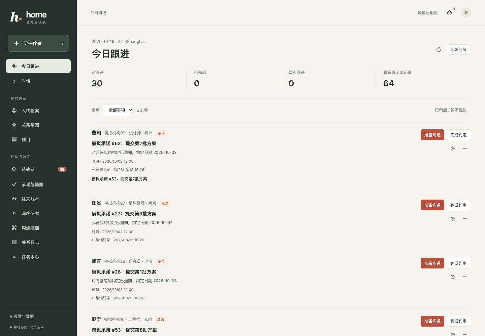

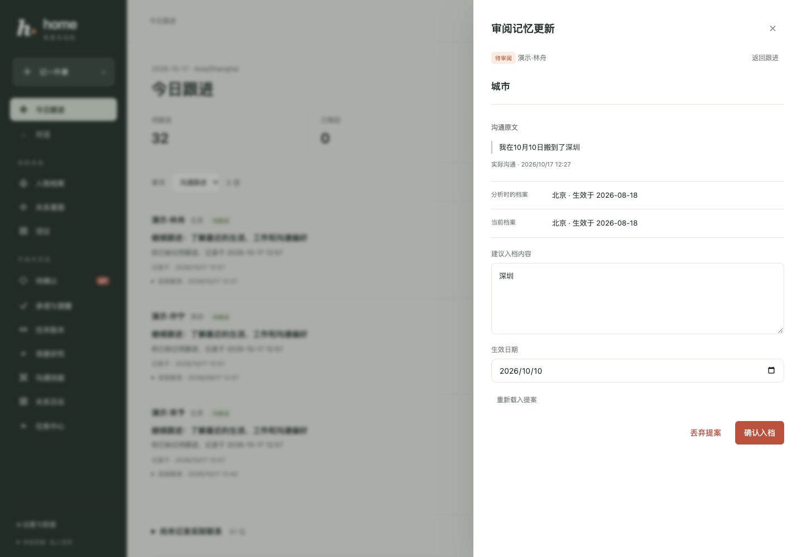

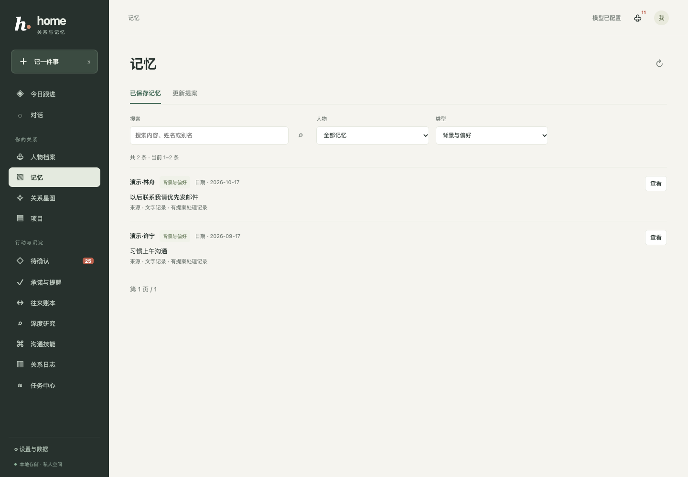

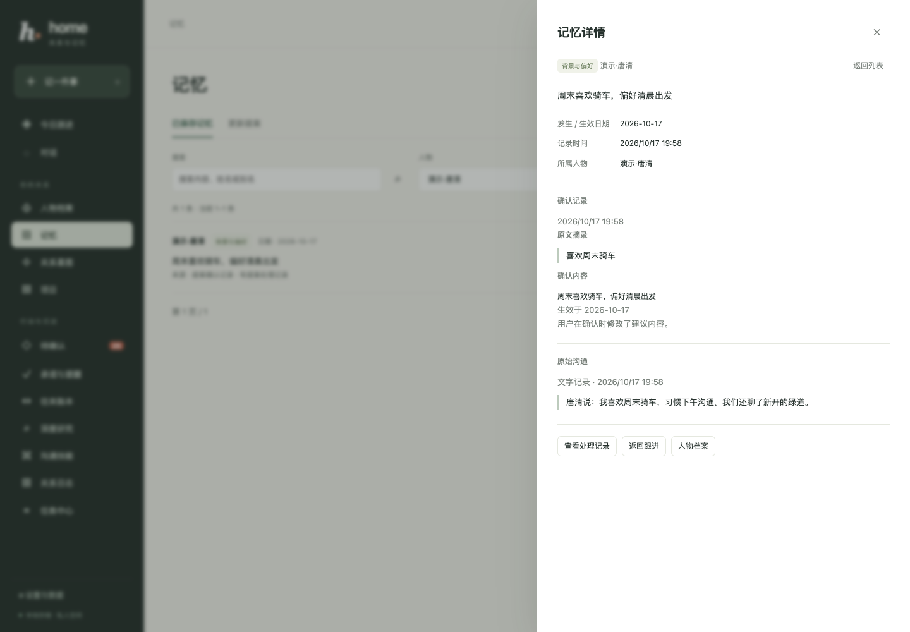

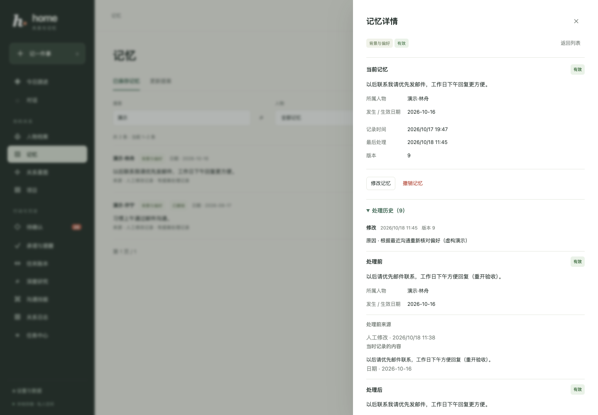

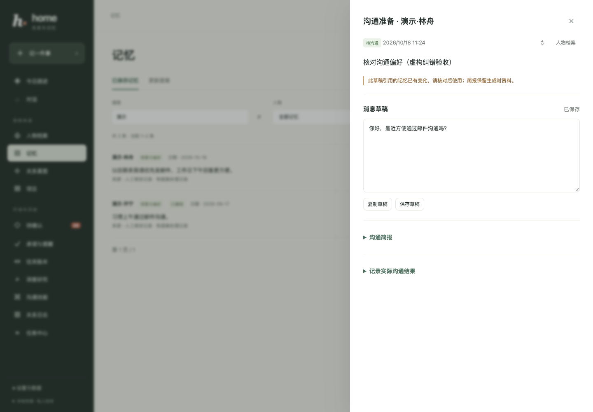

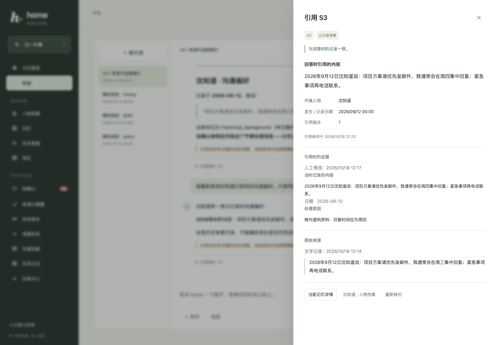

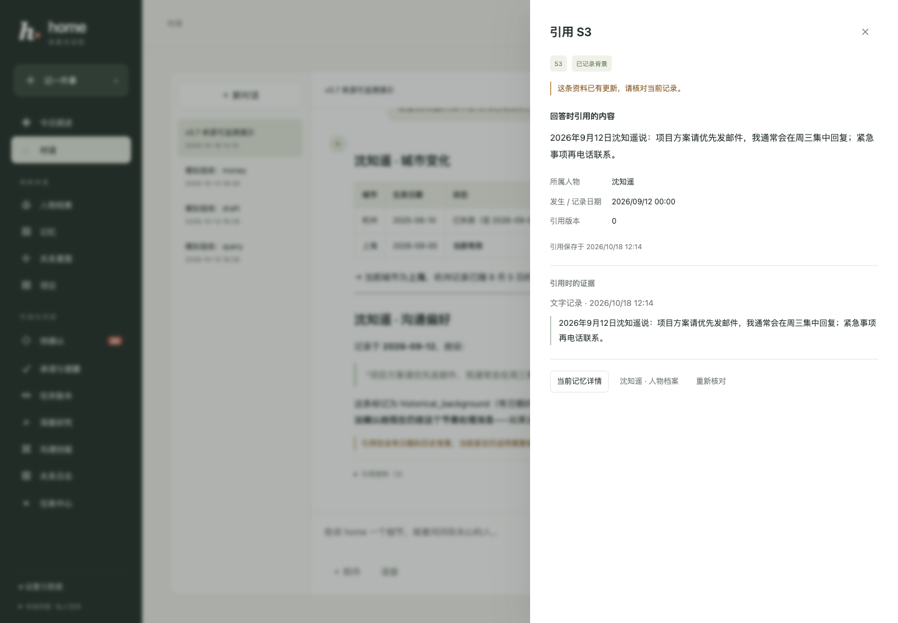

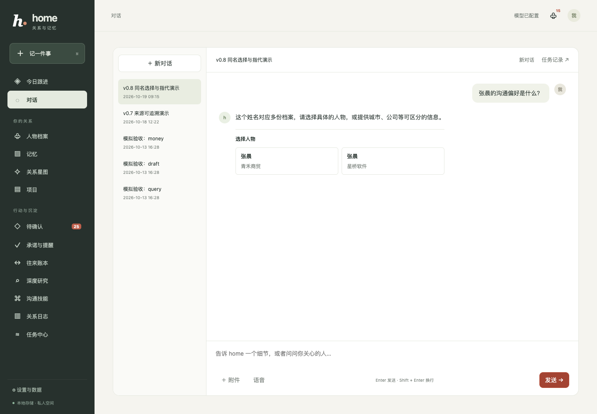

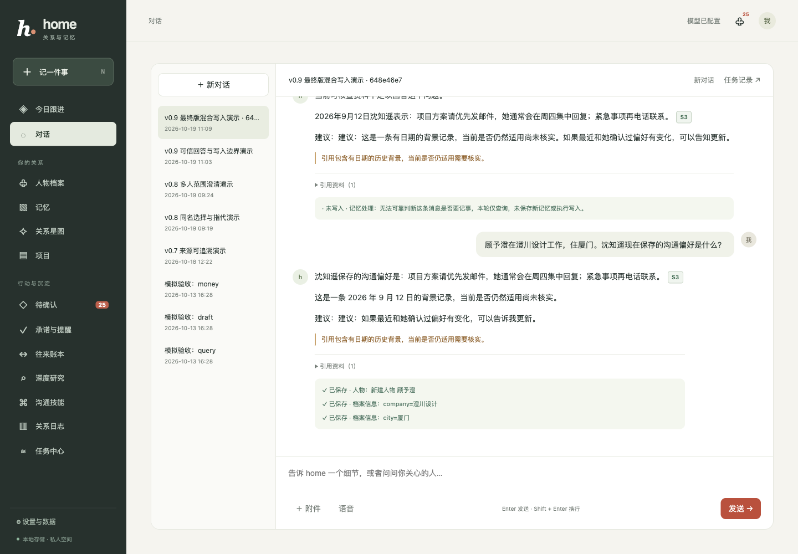

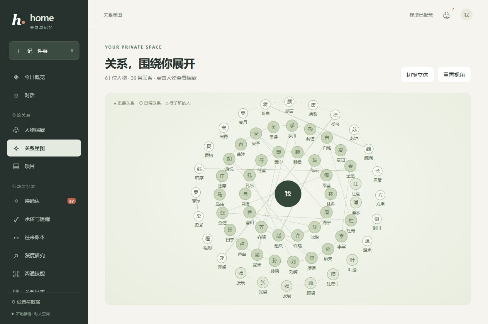

## 功能与入口

| 页面 | 可以做什么 | 行为说明 |
| --- | --- | --- |
| 今日跟进 | 查看到期承诺、跟进提醒、等待回复与超过联系周期的人；暂缓、忽略或直接准备沟通 | 每条事项提供原因、日期与来源，无联系记录的人单独列出 |
| 对话 | 记录事实、查询档案、比较人物、起草跟进；上传附件；选择同名人物；点击引用核对来源 | 单人话题可承接代词，切换人物后更新范围；多人或不明确指代先澄清。同名选择显示城市、公司等背景并继续原问题；旧引用保留快照并可核对当前状态 |
| 人物档案 | 搜索姓名与别名；看公司、职位、城市等字段、互动、承诺与来源 | 同名列表显示背景；当前字段和历史版本分别可查 |
| 沟通准备 | 在人物档案设置沟通目标，查看有日期与来源的简报，编辑和复制草稿，记录实际沟通结果 | 生成草稿不更新联系时间；确认结果后才记录联系、明确约定和下次提醒 |
| 记忆 | 按人物、类型和状态搜索已保存记忆；修改内容、日期和人物归属，撤销或恢复，查看来源及处理历史 | 撤销记忆退出后续检索和沟通背景；人物档案也提供记忆与待审阅入口 |
| 记忆更新 | 分析已记录的沟通结果，核对原文与档案，修改后确认或忽略人物近况和偏好提案 | 确认前不写入档案；历史时间、来源与处理结果保留，可从待确认进入审阅 |
| 待确认 | 选择人物身份；确认或丢弃字段、记忆、关系、承诺和账目 | 方向不明账目需选择收到或付出，并展示原文；确认前不计入汇总 |
| 承诺与提醒 | 查看我答应的、对方答应的事情及到期时间；标记完成 | 有到期日的承诺建立提醒，完成后取消尚未触发的关联提醒 |
| 往来账本 | 查看收支、按页浏览、修改或撤销确认账目、查看原始凭证 | 待确认与撤销不计入金额；默认每页 100 条，可继续翻页 |
| 项目 | 建立项目、关联人物与对话，在项目中提问 | 项目说明与成员资料进入该项目的问答上下文 |
| 沟通技能 | 新建、编辑、删除、JSON 导入导出；用 `/技能名` 调用 | 保存沟通步骤与语气，用于生成草稿 |
| 关系星图 | 查看人物与关系边，拖动立体视图，点击人物打开档案 | 按实际联系重要度排列；超过 24 位人物时默认平面布局，仍可切换立体 |
| 深度研究 | 准备提案、确认方向、检索阅读、核对来源、查看和下载报告 | 草稿逐步保存；资料较少会标明局限，失败可重试 |
| 关系日志 | 回顾一天的交流、承诺和资金往来；手动生成当日日志 | 运行中的定时任务也会生成日志，使用配置的本地时区 |
| 任务中心 | 查看队列、状态、进度、结果，取消和重试任务 | 数据与事件持久化，刷新能继续查看；进程中断有明确状态 |
| 设置与数据 | 查看模型映射、导出备份、管理归档和桌面通知 | 浏览器不会收到 API 密钥；通知需用户允许 |

## 安装与启动

### 环境要求

- 建议使用 Python **3.11 或更新版本**；本机验收使用 Windows 与 Python 3.12。
- 提供聊天、工具调用与视觉模型的兼容网关，以及对应 API 密钥。
- 浏览器。前端没有 Node 构建步骤；Node.js 仅用于可选的语法检查。

依赖列在 `requirements.txt`。当前未提供依赖锁文件，换机器安装后应运行自动测试验证环境。

### Windows / PowerShell

在项目根目录执行：

```powershell
python -m venv .venv
.venv/Scripts/python.exe -m pip install -r requirements.txt
if (-not (Test-Path .env)) { Copy-Item .env.example .env }
```

编辑 `.env`，填写 `HOME_LLM_API_KEY`，检查网关地址和模型名称。随后启动：

```powershell
.\run.ps1
```

打开 [本地工作台](http://127.0.0.1:8000)。脚本在后台运行服务，已有服务时返回地址；日志位于 `data/runtime/server.out.log` 和 `server.err.log`，启动进程 ID 记录在 `server.pid`。

需要前台查看日志、用 Ctrl+C 停止，或手动控制生命周期时：

```powershell
.venv/Scripts/python.exe -m uvicorn app.api.main:app --host 127.0.0.1 --port 8000
```

改端口可使用 `./run.ps1 -Port 8001`。修改 `.env` 或后端代码后需要重启；再次执行启动脚本不会自动替换正在运行的进程。后台模式停止时，应核对进程命令确实属于本项目，结束服务及其 Python 子进程后再启动。

### macOS / Linux

应用代码可以用同一个 Uvicorn 入口启动。0.3 在 macOS / Python 3.12 上完成自动回归和沟通流程的浏览器验收。Windows 后台脚本和旧模拟图片验收字体不适用于这些平台。

```bash
python3 -m venv .venv
.venv/bin/python -m pip install -r requirements.txt
test -f .env || cp .env.example .env
# 编辑 .env，填写网关密钥与可用模型。
.venv/bin/python -m uvicorn app.api.main:app --host 127.0.0.1 --port 8000
```

首次启动自动创建 SQLite 数据库，并按 `migrations/` 升级现有库。默认监听回环地址。本项目没有用户登录与多租户隔离，适合单机单用户使用；对公网开放前需要另行设计认证和部署方案。

## 沟通准备与实际联系

从人物档案点击「准备沟通」，填写本次目标。后台任务从该人物的当前字段、历史变化、有证据的背景记忆、实际联系及未完成承诺生成资料快照，并调用模型起草消息。简报保留生效时间、记录时间与来源；历史字段标明已经结束。草稿可编辑、保存与复制，未保存内容在当前浏览器本地恢复。应用不会代发消息。

实际联系后，在同一记录中填写沟通时间、渠道、实际内容和后续状态。只有点击「确认记录沟通结果」才新增实际联系。完成哪些旧承诺、新增什么明确约定、何时再跟进均由用户选择；不会从结果文本自动抽取。联系、承诺与提醒在同一事务中保存，重复请求不重复记账，旧版本修改会提示冲突。已完成记录只读，可以另建准备记录。

对话中的纯查询和无法可靠判定意图的消息只保留对话及审计证据；明确记事或混合消息中的记事片段才可进入抽取，相关资料互动保存为 `note`。草稿、文档和网页摄入也不会刷新上次联系时间。聊天导入只有在明确提供用户身份、用户当日参与、对方身份唯一且时间已知时，才把实际参与者记为 `contact`；仅被提及的人不计入联系。重要度与「好久没有联系」使用这一口径。

升级时，旧互动会保留为资料记录，原先混入资料提及的联系权重归零。旧记录无法可靠证明发生了联系，因此不会自动追认；这也意味着旧库可能显示「尚未记录实际联系」。请在升级前保留备份。资料来源校验只检查引用是否属于快照，不能证明模型草稿中的每句话都准确，发送前仍需核对。

## 今日跟进

首页按配置时区汇总当天及逾期事项，不调用模型排序。优先展示已到期的未完成承诺和跟进提醒，再展示等待回复至少三天、明确标记为待跟进且未另设提醒的沟通，以及超过个人联系周期的人。承诺关联的提醒合并呈现；已经完成、已归档、已被新提醒替代的事项不进入清单。等待回复期间若有更新的实际联系，旧等待事项也会退出；明确标记的待跟进事项仍需用户更新状态。

每条事项包含人物背景、具体原因、日期和来源。点击「准备沟通」会带入该事项的目标，确认后再生成草稿；已有沟通可以直接打开跟进记录。没有实际联系记录的人在独立区域显示，不会被算作长期未联系。

可以将当前事项暂缓到未来时间，或暂不跟进，并在暂缓记录中恢复。该选择持久化保存，刷新或重启后仍有效；到达暂缓时间后事项重新进入清单。新来源内容、人物归属或实际联系发生变化时，会按新的资料版本重新判断。清单选择不会自动完成承诺、修改实际联系时间或改变原始提醒的通知时间。

人物档案中可以设置联系周期，默认 14 天，范围 1 至 365 天；关闭周期建议后，明确的承诺和提醒仍会出现。已经明确安排未来沟通提醒的人，周期建议会等待该安排；取消、完成或已替换的跟进提醒不会阻止周期建议。合并人物使用存活方的周期设置，原人物的设置保留，在拆分后恢复生效。周期配置使用修订号检查，另一窗口的更新不会被静默覆盖。

## 沟通后的记忆更新

保存实际沟通结果后，可以单独分析该条结果中的人物近况、档案变化和沟通偏好。分析使用持久任务，失败、取消或应用中断后可以重试，不影响已经保存的实际联系。已结束的跟进也可以分析其历史结果。同一条结果重复点击或重试不会重复生成提案，已确认和已忽略的提案保留处理记录。

提案展示人物、原文片段、原档案、当前档案和信息发生日期。可以修改内容与日期，再逐项确认或忽略；全局「待确认」也能进入审阅。模型只提出候选，确认前不会自动修改字段或新增关系记忆，也不会再次记录联系、承诺、资金往来或提醒。人物归属与提案语义仍需人工核对，原文片段存在并不证明模型理解准确。

日期以这次实际沟通发生的本地日期为锚点，而不是分析当天。历史信息按生效时间插入字段版本，不覆盖更晚的近况。提案产生后若该字段的历史或当前版本发生变化，确认会提示冲突；重新核对档案后才能继续确认。人物合并或拆分导致来源人物归属变化时，旧提案不能直接套用到另一人物。确认写入的字段与记忆保留原结果的证据来源，后续沟通简报可以引用这些已确认资料。

### 查看已保存记忆与提案

左侧「记忆」提供「已保存记忆」与「更新提案」两个视图，支持搜索、人物和类型筛选及分页。提案可以按待审阅、已入档、已丢弃或全部查看，处理后仍保留记录。「待确认」中的提案继续使用同一个审阅流程。

人物档案中的「记忆与偏好」展示该人的近期记忆，可以进入完整列表或查看待审阅提案。记忆详情展示完整内容、生效或发生日期、记录时间和来源；用户修改后确认的条目分别展示确认记录与原始沟通，保留修改内容和原话的区别。历史摄入的已保存记忆不一定经过逐条人工确认。公司、城市等结构化信息仍在人物档案及「字段历史与来源」中查看。

### 修改、撤销和恢复记忆

打开已保存记忆的详情，可以修改正文、生效或发生日期、人物归属并记录原因；归属也可以改为个人记忆。记忆类型保持原值。修改保留同一个记忆 ID，原始来源与每次修改前后值分别留存，原提案的确认记录不会被改写。这些操作直接保存用户的判断，不调用模型。

误记的内容可以撤销，之后在「已撤销」筛选中查看并恢复。撤销后不会进入人物记忆预览、全文或向量检索、新对话检索、后续日志材料及新沟通简报；恢复人物档案也不会自动恢复单独撤销的记忆。编辑后旧向量失效，全文索引立即更新；可选向量不会在纠错时重新调用模型生成。

操作按修订号检查版本，另一窗口修改后会要求重新核对当前值，保留尚未提交的表单。相同请求重复发送不会重复写入处理历史。人物合并、拆分与归档也会更新修订号；拆分不会覆盖合并之后用户手动调整的记忆归属。

已经生成的沟通简报和草稿保留当时快照。引用的记忆后来被修改、撤销、转移或变得不可见时，打开记录会提示来源变化；不会悄悄替换旧简报。生成新草稿期间若引用记忆发生变化，本次生成会失败并提示重试，重试使用最新有效资料。旧会话消息和既有日志等已生成内容不会自动重写。

## 对话中的记忆引用

0.9 在回答前区分查询、记事与混合消息。查询不能通过后续写工具新增记忆；混合消息仅将校验后的记事原话用于抽取。完整原文保留在会话，审计证据保留至多 4000 字符摘录及消息关联，分类保存原文哈希。分类失败保守只读，重试复用已保存的决定。分类仍可能判断错误，不能据此承诺任意问法都能准确识别。

0.10 的分类阶段最多请求两次，只重试可恢复的请求或响应格式故障；保存安全的失败类别、结束原因与用量，不保存供应商异常正文。分类失败或无法判断的用户消息下方提供「重新分析原消息」：明确操作后新增关联消息与任务，原消息和原回答保留；如果重新确认原文含记事内容，才允许保存。同一原消息重复点击返回同一任务，已授权记事、已保存或已有待确认记录的消息不能再走此入口。普通任务重试仍复用原分类。多次显式分析也沿用最初问题的人物范围和历史，旧消息中的相对日期按原消息发送日解析。

在唯一记忆的回答之后，可以追问「这条记忆是什么时候被我修改的？」。系统按上一条终稿的真实引用绑定记忆，重新读库，并用固定模板分别给出所标日期、首次录入日期、人工编辑日期及恢复操作日期；没有编辑审计就说明未知。上一回答涉及多条记忆时先澄清，转移、撤销或人物不可用时也不能猜。此模板仅支持明确日期问法；其他问题仍通过正常模型回答及来源核验。

回答草稿之后最多进行一次资料修订。事实段附本轮来源，建议单独标明；资料不足和处理回执采用服务端固定说明。回执中的成功、待确认与失败取自实际执行结果。状态、事实时效、记忆所标日期、录入、人工编辑与恢复时间分别提供给模型。修订失败保留原稿并提示核对；引用校验与模型修订均不代表语义认证。具体实现、真实采样与保守限制见 [0.9 记忆问答可信度](docs/ANSWER_TRUST_V09.md)。

回答中的 `S1`、`S2` 等引用按钮，以及回答下方的「引用资料」，可打开该条回答实际引用的档案字段、背景记忆或沟通记录。详情展示回答时的内容、所属人物、发生或生效日期、原始证据，以及修改或确认记录；来源为附件或网页时可以打开原件。引用在回答保存完成后出现，流式生成期间的标记暂不提供点击。

「当时的当前档案」与「历史档案」分别表示回答时有效和已结束的字段版本。「已记录背景」只表示这条有日期的记忆尚未撤销，不能证明偏好或状态现在仍然成立。引用只能证明资料确实被读取，不能证明模型每句话及推论都正确；未附引用、无法核验的编号和历史背景均会提示核对。代码示例和普通链接中的标记不作为资料引用。

旧回答保留原文和引用快照。点击引用会重新判断资料是否更新、撤销、转移或不可用；「当前记忆详情」可查看最新记录。本版本还保存回答读取过的背景依赖，即使没有在正文逐项引用，资料变化后也会停止把这条旧回答作为后续上下文中的事实依据，并使相关摘要重新生成。旧版本未保存依赖的历史消息无法补做完整核验，不会被自动改写。

回答生成期间，如果已读取的来源或档案卡发生变化，最终回答不会保存，任务会提示重试；重试重新读取有效资料。同名人物需要选择人物 ID，指定人物或个人记忆范围时，全文与可选向量通道都先过滤范围，再截取候选。自动注入档案和多轮工具读取受上下文预算约束，达到预算会要求缩小范围或新建对话。

0.8 在用户消息上保存本轮人物范围。明确单人后的“他 / 她”沿用这位人物；切换人物会更新范围；多人、同名、不明确或失效的指代需要先选择。候选按钮显示姓名与可区分背景，选择后继续该次原问题；不会把“第二个”或模型工具读取顺序当成身份依据。重试旧问题只读取截至该问题的历史，也不使用包含后续回合的摘要。

这些规则约束自动背景与 `get_person` / `query_memory` 的读取，不是多用户权限系统，也不是语义正确性保证。已有会话仍可保留其他人物的历史陈述，共同参与的原始沟通也可能提及其他人。模型仍可能漏引、误述日期或作出来源不能支持的推论，应结合引用原文核对。

### 离线检索回归

```sh
.venv/bin/python -m eval.memory_retrieval
.venv/bin/python -m eval.memory_retrieval --json --output /tmp/home-retrieval.json
```

评测每个场景使用独立的临时 SQLite 数据库，调用实际工具和 FTS5，禁止网络与模型调用，不修改工作数据库。固定样本覆盖修改、撤销恢复、归属转移、归档、同名隔离、个人范围、当前与历史字段以及沟通来源。报告包含逐项结果、配置的 top-k、平均召回、MRR 和来源快照校验；本轮结果见 [0.7 检索报告](eval/results/memory-retrieval-v07-20261018.json)。这些合成回归结果不代表全新真实数据、embedding 效果或大模型回答的语义准确率。

0.8 的两轨评测使用同一批虚构资料与自然语言问题：

```sh
# 固定自然问法的排名、范围和来源检查，不调用模型
.venv/bin/python -m eval.memory_questions --track retrieval
# 真实抽取 + 工具 + 回答，无缓存，每组对话独立数据库，会调用配置的模型
.venv/bin/python -m eval.memory_questions --track answers --repeat 2
```

固定集有 16 个检索/来源场景，以及 6 组对话、每次重复 13 个回答。报告分别展示 Recall@1/3/5、MRR@5、确定性检查、有限字符串规则、原始回答、实际工具轨迹与抽取副作用，并导出逐轮审阅材料。`--app-root` 可对同一批问题运行旧代码；`--worker-timeout` 限制单场景用时，报告逐场景保存。有限字符串规则与真实来源均不能证明回答语义正确；人工评测仍待开展。运行与已知失败见 [0.8 验收报告](docs/MEMORY_QUALITY_V08.md) 和 [评测说明](eval/README.md)。

## 模型与存储配置

配置由 `app/config.py` 从根目录 `.env` 和 `HOME_` 环境变量读取，环境变量优先。相对数据库与附件路径按项目根目录解析。

`.env.example` 提供当前已验收网关的默认模型映射，不包含真实密钥：

| 配置项 | 示例默认值 | 用途 |
| --- | --- | --- |
| `HOME_LLM_BASE_URL` | `https://token-hub.ailyn.com.cn/v1` | 模型网关入口 |
| `HOME_LLM_API_KEY` | 空，需要自行填写 | 网关认证，仅保存在本地配置 |
| `HOME_MODEL_MID` | `deepseek-v4-flash` | 对话、工具调用、结构化抽取 |
| `HOME_MODEL_MINI` | `qwen3.7-flash` | 日志与历史摘要 |
| `HOME_MODEL_THINK` | `deepseek-v4-pro` | 来源审查与后台归纳 |
| `HOME_MODEL_PRO` | `qwen3.8-max` | 研究报告合成 |
| `HOME_MODEL_VISION` | `qwen3.8-max` | 截图转写 |
| `HOME_MODEL_EMBED` | 空 | 可选向量检索；留空时使用结构化与全文检索 |
| `HOME_DB_PATH` | `./data/home.db` | SQLite 数据库 |
| `HOME_BLOB_DIR` | `./data/blobs` | 原始附件 |
| `HOME_TIMEZONE` | `Asia/Shanghai` | 日期解释、提醒、日志与周反思时区 |

`HOME_DATA_DIR` 也保留在配置中，但数据库与附件实际位置分别由 `HOME_DB_PATH`、`HOME_BLOB_DIR` 决定；仅修改前者不会自动移动已有数据。

模型名称需要与实际网关一致。非流式请求显式指定 `stream=False`，兼容本轮网关默认返回 SSE 的行为。更换网关后仍需验证工具调用、JSON 输出和视觉输入；没有配置 embedding 模型时不会启用向量通道。

通过 [连接状态](http://127.0.0.1:8000/api/status) 或设置页查看映射。`configured=true` 仅表示密钥已配置，不能据此确认认证、额度或所有模型都可用。

## 恢复演示数据

`demo/` 包含当前模拟工作台的数据库快照和 3 份原始附件，包含 71 位人物（66 位可见）、220 个字段版本、347 次互动、126 条记忆、69 条承诺、131 笔账目、32 条确认记录、3 个项目、30 个任务（29 完成、1 部分完成），以及 9 个会话中的 47 条存储消息（含 5 条工具消息）。0.7 的城市历史与纠错引用、0.8 的同名选择及 0.9 的 6 轮真实网关演示均保留原文；0.10 新增联系偏好查询、日期追问和原失败消息的明确重新分析。失败回执与原回答的表述问题也保留。这些是虚构产品演示，不是准确率基准，详见[演示说明](demo/README.md)。安装依赖后、首次启动前，在项目根目录执行：

```powershell
# Windows
.venv/Scripts/python.exe -m scripts.restore_demo
```

```sh
# macOS / Linux
.venv/bin/python -m scripts.restore_demo
```

恢复命令读取 `.env` 和环境变量中的 `HOME_DB_PATH`、`HOME_BLOB_DIR`，默认写入 `data/home.db` 和 `data/blobs/`。随后按上面的正常启动方式运行，即可看到演示数据。

命令校验附件完整性，已有数据库会拒绝覆盖；若需要保留已有库，可把这两个配置指向新的本地目录，再恢复并使用相同配置启动。运行中的数据继续保存在被 Git 忽略的 `data/`，不会修改仓库里的固定快照。`.env` 和 API 密钥不提交，另一台机器仍需单独配置模型访问。

## 第一次使用

### 1. 记录与查询

先输入一条虚构资料：

```text
张晨目前在杭州星桥软件做设计师。我答应2026-10-09前给他发送合作方案。
```

查看回答下面的保存回执，再打开人物档案。公司、职位、城市应有来源；承诺页面应显示事项与日期。接着询问：

```text
张晨现在在哪里工作？我答应过他什么？
```

对明确的查询或起草操作要求设置了过滤，避免把「用户要求查询档案」当成人物事实。但模型仍可能理解错误，保存回执和来源是日常核对入口。

### 2. 导入聊天与附件

点击「记一件事」或对话附件入口。聊天记录使用专门的导入模式，并填写导出记录中代表自己的名字，例如「我」或昵称。

```text
[2026-10-01 09:00:00] 我: 潘念，我答应10月22日前给你发运输清单。
[2026-10-01 09:01:00] 潘念: 我在长风物流做运营经理，目前住宁波。
```

普通文本、文档、网页和截图会进入相应解析或转写流程。上传立即返回任务，可以在任务中心查看结果。重复文件返回重复回执，避免重新累计同一份数据。

### 3. 处理同名与不确定信息

多个「张晨」或同一个「小张」指向多个人时，整个人物补丁暂挂，等待选择已有档案或新人物。候选按钮附带公司、职位或城市。

信息默认按置信度处理：`≥0.85` 可自动写入、`0.60≤置信度<0.85` 待确认、低于 `0.60` 跳过；来源校验失败会降低置信度。身份匹配还比较候选差距，具体规则见 `app/config.py` 和 `app/memory/disambiguate.py`。

回执的「已保存」表示写入完成，不保证语义一定正确。待确认页提供确认与丢弃；同一来源重试保留已做出的丢弃决定。

### 4. 修改错误记录

人物当前字段可以修改；「纠错」提供删除当前版本、转移归属，历史版本可以恢复。删除结束当前版本而保留历史；恢复新增当前版本，不抹掉删除至恢复之间的时间空档。转移保留证据，接收人物已有同类字段时必须明确选择替换。

账本可修改已确认账目的关联人物、方向、金额、日期和事项，也可撤销。撤销条目退出汇总，通过「查看已撤销」查阅凭证与修改记录。纠错保留原始去重键，原来源重放不会重新恢复旧账。

字段提交携带版本、账目提交携带修订号；过期页面发生冲突时返回 `409`，应重新读取再操作。写入和审计记录在同一事务中提交。

### 5. 起草与研究

在档案中点「起草跟进消息」，或直接要求依据已有资料起草。技能保存常用语气与步骤。当前没有外部消息发送服务，草稿由你查看和使用。

研究先生成提案，确认后按三个方向检索和阅读。审查使用抓取的原文片段，报告包含来源链接与核验依据；提供公开 URL 时可限定相应网站资料。原文抓取失败、资料不足或仅有单一来源时，结论有相应局限。

## 任务、提醒与失败处理

耗时操作由 `app/jobs/tasks.py` 的本地线程池执行，最多 3 个工作线程。任务、结果、取消标记和 SSE 事件保存在 SQLite。

| 状态 | 含义 | 操作 |
| --- | --- | --- |
| `queued` / `running` | 等待或执行中 | 查看进度，可请求取消；同一会话只允许一个回复任务 |
| `done` | 流程已完成 | 查看逐条回执与最终结果 |
| `partial` | 部分完成，可能有待确认、截断或局部失败 | 查看原因，处理待确认，必要时重试 |
| `failed` | 执行失败 | 检查错误与模型连接，再重试 |
| `cancelled` | 请求取消后，执行到检查点停止 | 已保存内容保留，取消不会回滚此前全部写入 |
| `interrupted` | 应用退出时仍在执行 | 重启后明确标记，可手动重试；原排队任务继续调度 |

刷新后能恢复任务结果和已保存事件；服务关闭期间不能继续推理或发提醒。SSE 支持 `after` 游标读取事件，重试复用任务并依赖来源去重规则。

定时任务使用 `HOME_TIMEZONE`：每分钟检查到期提醒，每天 **23:50** 生成当日日志，每周日 **23:00** 归纳反思。只有应用运行时才执行；不提供关机后推送或可靠的停机期间日志补生成。

## 批量模拟数据与验收

生成脚本限制输出在 `data/qa/`，拒绝覆盖已有数据库。正式数据与模拟数据分开存储。

```powershell
# 只生成数据量，不调用模型。
.venv/Scripts/python.exe -m scripts.mock_scenarios

# 生成数据并真实调用网关抽取 36 条样本。
.venv/Scripts/python.exe -m scripts.mock_scenarios --live
```

场景覆盖多人、同名与别名、历史日期、更正、角色词、否定、假设、客套、报价、收入情况、实际转账、纯查询和起草。原始输出和结果保存在独立目录；`data/qa/latest-mock.json` 指向最近生成的库。

运行模拟工作台时，在**独立 PowerShell 终端**设置测试路径，避免正式服务继承这些环境变量：

```powershell
$mockRun = (Get-Content data/qa/latest-mock.json -Raw | ConvertFrom-Json).run_dir
$env:HOME_DB_PATH = Join-Path $mockRun 'home.db'
$env:HOME_BLOB_DIR = Join-Path $mockRun 'blobs'
.venv/Scripts/python.exe -m uvicorn app.api.main:app --host 127.0.0.1 --port 8767
```

打开 [模拟工作台](http://127.0.0.1:8767)。生成新库后需要停止旧的 8767 服务再启动，不能只更新指针而继续使用旧进程。

另一个终端执行完整链路验收：

```powershell
.venv/Scripts/python.exe -m scripts.mock_e2e
```

脚本先核对服务人物 ID 与测试库一致，要求新库还没有任务；实际执行三种对话、名片和收款图片识别、群聊导入、重复提交及 HTTP 并发读取。图片测试依赖 Windows 的 `msyh.ttc` 字体。已有完整 `--live` 输出时，可用 `python -m scripts.mock_replay` 重放到新库，再重启服务复测。

截图和已测数量来自完成抽取、重放与完整链路后的库；仅运行不带 `--live` 的命令时，数量会较少。数据规模与断言见 [模拟验收说明](docs/MOCK_QA.md)。克隆仓库包含 `demo/` 下的虚构演示快照，可按「恢复演示数据」载入；本机 `data/` 下的测试库和原始日志不入库。

## 开发与测试

```powershell
# 不依赖真实网关的自动回归：每项使用隔离测试库。
.venv/Scripts/python.exe -m pytest -q

# 可选静态检查。
node --check web/app.js
.venv/Scripts/python.exe -m compileall -q app scripts
git diff --check

# 真实模型抽取评测，会产生 API 调用。
.venv/Scripts/python.exe -m eval.run --split holdout --repeat 1 --no-cache --concurrency 2
```

更稳健的模型评估可使用 `--repeat 3` 观察多次采样，按最差一次判定。tune 与 holdout 分别报告；不能把调整过提示词的用例继续当作独立泛化证据。抽取后处理变化时应使用 `--no-cache`，避免读到旧处理结果。评测协议见 [评测说明](eval/README.md)。

自动回归覆盖跨入口写入、同名歧义、置信度与来源、账目和承诺去重、待确认、历史字段、手动纠错、修订冲突与事务回滚、归档检索、取消恢复、SSE 游标、项目技能、备份、JSON 解析和账本分页。0.3 另覆盖真实联系口径、沟通快照与草稿、结果幂等、提醒替换、人物合并拆分和沟通任务清除。

0.6 增加已保存记忆的修改与撤销恢复、请求幂等、独立数据库连接的版本冲突、全文索引与旧向量缓存、稳定 ID、归档和人物归属变化、审计失败回滚、来源链清理，以及历史简报不改写、生成期间来源变化拒绝保存与重试。

## 架构与代码目录

```text
浏览器 / 原始文件 / 聊天导出 / 网页
                    ↓
FastAPI → 持久任务 → 解析或转写 → 模型抽取 / Agent 工具
                    ↓
身份消歧 → 来源与置信度检查 → 统一写入 / 待确认 / 去重
                    ↓
SQLite：人物、字段历史、记忆、互动、承诺、账目、证据、任务事件
                    ↓
结构化与全文检索 → 档案、对话、项目、提醒、日志和研究报告
```

| 路径 | 职责 |
| --- | --- |
| `app/api/main.py` | 应用生命周期、静态文件、基础与兼容 API |
| `app/api/workspace.py` | 工作台、异步任务、纠错、项目技能、账本和导出 API |
| `app/api/followups.py`、`app/agent/followup.py` | 沟通简报与草稿、版本检查、明确结果的原子保存 |
| `app/api/agenda.py`、`app/agent/agenda.py` | 今日跟进候选、优先级、来源版本、暂缓与人物联系周期 |
| `app/api/outcome_memory.py`、`app/agent/outcome_memory.py` | 沟通结果分析、带来源的记忆提案、版本核对与确认入档 |
| `app/api/memories.py`、`app/memory/memory_corrections.py` | 记忆与提案浏览、来源详情，记忆纠错、撤销恢复、幂等与处理历史 |
| `app/agent/` | 工具、上下文编排、流式回答、研究提案与来源审查 |
| `app/ingest/` | 聊天发言人和日期解析、文档解析、截图转写、网页正文 |
| `app/memory/` | 抽取、统一写入、身份消歧、确认、纠错、档案编译与检索 |
| `app/store/` | SQLite schema、迁移执行、数据访问、附件内容寻址存储 |
| `app/jobs/` | 持久任务与定时提醒、日志、周反思 |
| `migrations/` | 从原 schema 升级任务、会话锁、纠错审计、互动类型与沟通跟进表 |
| `web/` | 无需构建的前端及本地 Markdown/HTML 清理依赖 |
| `tests/`、`eval/` | 自动回归、不变量与真实模型抽取评测 |
| `scripts/` | 批量模拟、缓存输出重放和完整链路验收 |
| `docs/` | 初始审查、交付验收、模拟验收与虚构数据截图 |
| `data/` | 本机数据库、附件和日志，被 Git 忽略 |

SQLite 使用 WAL、外键和忙等待；字段记录生效时间与记录时间，支持历史查询。逐条抽取写入用保存点隔离局部失败，纠错通过事务序列化版本检查与审计。

前端本地分发的 Marked 与 DOMPurify 版本、来源和许可证见 [第三方依赖说明](web/vendor/THIRD_PARTY.md)。

## 常用 API

完整结构可在启动后查看 [Swagger 文档](http://127.0.0.1:8000/docs) 与 [OpenAPI JSON](http://127.0.0.1:8000/openapi.json)。下面是工作台常用入口；旧同步摄入和对话接口保留兼容。

| 请求 | 用途 |
| --- | --- |
| `GET /api/status`、`GET /api/home` | 配置状态与今日概览 |
| `GET /api/agenda?include_hidden=true` | 今日跟进、暂缓事项及尚无实际联系记录的人 |
| `POST /api/agenda/actions` | 按事项 ID 与来源指纹暂缓、忽略或恢复当前版本 |
| `GET/PATCH /api/persons/{pid}/contact-policy` | 读取或按 `expected_revision` 更新联系周期 |
| `POST /api/followup-outcomes/{oid}/memory-analysis` | 幂等提交沟通结果分析任务 |
| `GET /api/followups/{fid}/memory-updates` | 读取每条沟通结果的任务与提案历史 |
| `GET /api/memory-updates/{id}`、`POST /api/memory-updates/{id}/resolve` | 审阅提案，按修订号确认、忽略或重新核对档案 |
| `GET /api/memories`、`GET /api/memories/{id}` | 按人物、类型、关键词分页查看已保存记忆及完整来源；`status=active/withdrawn/all` 筛选状态，`scope=personal` 查看个人或全局记忆 |
| `POST /api/memories/{id}/correct` | 提交 `action=edit/withdraw/restore`、`expected_revision` 与 `request_id`，修改记忆或撤销恢复；编辑可提交 `text`、`valid_from`、`person_id` |
| `GET /api/memories/{id}/history` | 查看每次处理的前后值、原因、时间、修订号及来源 |
| `GET /api/memory-updates` | 按人物、提案类型和处理状态搜索、分页查看记忆更新提案 |
| `POST /api/conversations` | 创建会话，可关联 `project_id` |
| `POST /api/conversations/{cid}/turns` | 提交一轮对话，返回 `202` 与任务；`request_id` 用于幂等 |
| `POST /api/conversations/{cid}/messages/{mid}/reanalyze` | 明确重新分析未授权写入的用户原消息；保留旧决定，同一消息重复请求返回同一任务 |
| `GET /api/tasks/{tid}`、`GET /api/tasks/{tid}/events?after=0` | 任务状态与 SSE 事件 |
| `GET /api/conversations/{cid}/messages/{mid}/sources/{sid}` | 查看该条回答保存的引用快照及当前来源状态 |
| `POST /api/tasks/{tid}/cancel`、`POST /api/tasks/{tid}/retry` | 取消和重试 |
| `POST /api/tasks/file`、`POST /api/tasks/url` | 文件/聊天导出和公开网页摄入 |
| `GET /api/persons`、`GET /api/persons/{pid}` | 人物列表与档案 |
| `GET /api/persons/{pid}/history?at=2026-10-01` | 查询历史日期有效字段 |
| `POST/GET /api/persons/{pid}/followups` | 提交沟通目标并返回准备任务，或列出跟进记录 |
| `GET /api/followups/{fid}`、`PATCH /api/followups/{fid}/draft` | 查看简报、草稿与结果，按 `expected_revision` 保存草稿 |
| `POST /api/followups/{fid}/outcomes` | 按 `request_id` 和 `expected_revision` 确认实际联系、明确承诺与提醒 |
| `POST /api/persons/{pid}/fields`、`POST /api/persons/{pid}/fields/correct` | 设置字段、删除当前版本、恢复或转移 |
| `GET /api/pending`、`POST /api/pending/{pid}/resolve` | 待确认列表与处理 |
| `GET /api/promises`、`POST /api/promises/{pid}/complete` | 未完成承诺与完成操作 |
| `GET /api/ledger?limit=100&offset=0&include_void=false` | 账本分页与全局汇总，返回 `has_more` |
| `PATCH /api/ledger/{lid}`、`POST /api/ledger/{lid}/void` | 修改与撤销确认账目 |
| `GET/POST /api/projects`、`GET/POST /api/skills` | 项目与沟通技能 |
| `POST /api/research`、`POST /api/research/{rid}/start` | 准备提案与确认执行 |
| `GET /api/evidence/{eid}/file`、`GET /api/export` | 原始附件与完整备份 |

账目金额使用整数分；`direction=in` 表示我收到，`out` 表示我付出。抽取与工具输入必须是有限正数，精确到分，最多 1 万亿人民币；更细的小数不会自动四舍五入，异常金额会被过滤或由工具返回错误。

抽取缺失或给出无效方向时，会先尝试核对原文明示的双方和金额；仍无法确定，就建立待确认项，不预设为支出，也不先写入账本。界面提供「确认收到」「确认付出」；API 确认时需提交 `{"action":"confirm","direction":"in"}` 或 `out`。缺少选择返回 `400`，非法方向返回 `422`。确认、丢弃及跨天重放都不会重复创建同一来源的记录。

异常置信度（如 `NaN`、无穷大、布尔值或不可解析文本）按 0 处理，不触发自动保存；畸形集合和对象形式的字段值会被跳过，同批有效信息仍可处理。缺失置信度仍按各类型既有默认值处理。这些校验不能判断每条语义陈述是否真实。

纠错请求需要提供相应版本或修订号。新任务事件有递增 `seq`，用于去重与恢复显示。

## 数据、归档与备份

默认数据在 `data/home.db` 和 `data/blobs/`，模型密钥在 `.env`。这些路径均被 Git 忽略。

| 操作 | 效果 | 保留内容 |
| --- | --- | --- |
| 删除当前字段 | 关闭该字段当前版本 | 历史、原始证据、纠错记录 |
| 撤销账目 | 退出收支汇总 | 原账目、凭证与修订记录 |
| 归档人物 | 隐藏普通档案、检索、全局账本和提醒，可恢复 | 历史数据；过去对话、任务回执和已生成日志 |
| 彻底清除人物 | 删除关联结构化记录、独占互动、独占凭证和附件 | 涉及他人的共享原文不会连带删除，其他历史文本可能仍含该人物 |
| 导出备份 | SQLite backup 生成快照，打包原始附件 | ZIP 含 `home.db` 和 `blobs/`，不含 `.env` |

备份从设置页下载，或访问 `/api/export`。迁移与恢复时：

1. 停止应用，先保留当前数据库及附件的副本。
2. 将备份中的 `home.db`、`blobs/` 恢复到实际配置位置；不要覆盖正在运行的数据库文件。
3. 单独保留或重新配置 `.env`，启动后核对人物、历史、账目和附件。

清除人物不等同于抹除全部历史文本；需要匿名化对话、日志或共享材料时，应另行审查。推理需要把相关内容发送到配置网关，应用不承诺完全离线处理。

## 常见问题

| 现象 | 检查与处理 |
| --- | --- |
| 启动失败或端口占用 | 查看 `data/runtime/server.err.log`；核对环境、依赖和端口。避免多个进程同时使用同一库 |
| 模型已配置仍无法回答 | 状态接口没有测试认证；检查任务错误、密钥、额度、网关和模型名 |
| 上传后没有新事实 | 查看回执，可能是重复文件、待确认、置信度低、没有可抽信息或解析失败 |
| 人物归错档案 | 检查同名/别名待确认；用字段转移纠错，不要直接删除原始证据 |
| 修改返回 `409` | 记录版本已经改变；重新打开档案或账目，基于最新内容提交 |
| 关闭后提醒没出现 | 服务需持续运行；桌面通知需浏览器授权，关闭应用会停止检查 |
| 研究没有来源或内容薄 | 搜索可能缺失、受限或无关；可提供公开资料 URL，仍需核对局限 |
| 历史城市没变成当前城市 | 过去信息保留历史版本；按该日期查询，不覆盖当前字段 |
| 模拟库与界面数量不同 | 旧 8767 进程仍用原库；停止后按新 `latest-mock.json` 重启 |

## 当前边界与后续方向

没有接入微信等 IM 账号、云浏览器登录代操作或自动外发消息。语音按钮依赖浏览器语音识别及麦克风权限；没有录音文件 ASR 和视频分析。星图使用 SVG 平面与立体投影。

上传任务限制为 50 MB，聊天单轮限制 3 万字符。PDF 取前 50 页，Word 取前 20 张表，Excel 取前 10 个工作表及每表前 500 行，CSV 取前 500 行；多数解析正文截取约 2 万字符。PDF 只提取文本层，没有扫描 PDF 逐页 OCR。聊天导出默认最多处理最近 20 个片段，返回 `truncated` 与使用数量。网页通过 HTTP 获取正文，不支持登录后或完全依赖脚本渲染的内容。

抽取、来源判断、研究与沟通建议仍可能有语义错误；待确认、引用和人工纠错不能保证发现每个错误。向量检索尚未启用，已有 FTS 合成回归不覆盖真实语义检索质量；当前尚无自动的语义矛盾消解。应用没有多用户认证和生产部署方案，依赖未锁定版本。

后续优先补充真实数据回归与多次采样、独立的语义检索与回答质量评测，提高复杂语义的归属与收支判断，完善依赖与部署复现，再按需求接入 IM、录音与外部消息服务。这些方向尚未计入已完成范围。

旧 README 的功能点计数与历史模型成绩不再作为当前完成率依据。[初始审查](docs/PROJECT_AUDIT.md) 保留修改前的问题；[交付说明](docs/DELIVERY.md) 与 [模拟验收](docs/MOCK_QA.md) 描述实际行为和验证结果。
