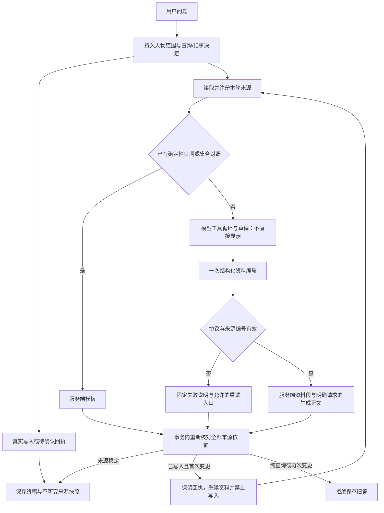

# 0.13 资料回答与完整关系工作流

日期：2026-10-20。版本：0.13.0。分支：`home/answer-evidence-v013`，基于 `38a4d27`。

## 回答的变化

0.12 的确定性日期和集合文字对照继续保留。0.13 把首轮查询、明确换人后查询和其他资料问答中的关键事实也交给服务端展示：模型选择本轮已注册来源，人物名称、档案项目、保存文字、时间角色、记录状态和文字核对结果由来源快照生成。模型给出的自由事实段会转换为对应资料记录，不能通过改写原文补出性别、日期或适用范围。

每条资料分别展示保存文字及来源入口。原文最多显示1600字符，并明确标记截断；完整快照和原始证据保留在资料入口。原文、姓名、字段名称均按字面显示，包含 `[[S999]]`、HTML、Markdown 或代码围栏也不会变成引用按钮、隐藏相邻资料或执行指令。无法忠实安全显示的控制字符会使核对失败，不用改写原文掩盖问题。

日期分别列出记忆所标日期、首次录入、最近人工编辑，以及确有审计时的撤销或恢复操作。档案字段列出生效、录入及结束时间；互动列出发生和录入时间。未知保持未知，不用更新时间或版本推断。记录当前可读取不证明内容现在仍成立；文字与摘录一致只说明当前字符串相同，不证明历史从未修改、当事人逐字说过或原始资料完整。

普通资料查询不展示模型附加的自由建议或人物解释；澄清使用固定提示。明确请求起草、文本缩短/翻译/润色、行动建议、倾诉或问候时可保留生成正文，单独标记并按字面展示。资料事实仍由服务端资料段提供，实际保存状态以服务端回执为准。展示模式和查询/记事写入决定相互独立，不会因为需要草稿就获准保存。

展示模式使用保守的语言规则，元数据记录 `method=conservative_language_heuristic` 和 `semantic_verified=false`。它使用局部否定与转折、文本操作指令及历史回查保护，仍可能漏识别请求或误判表达。模型选择来源是否相关、生成正文是否忠实于条件仍需核对；本次没有把它们变成代码可证明的语义结论。



## 协议与失败恢复

分类器和资料编辑共享严格 JSON 解析器：接受完整单对象，或完整单个标记为 `json` 的代码围栏；拒绝杂文、多个对象、重复键、非有限数和越界深度。围栏仅是传输封装，不放宽字段、来源、记事原文片段或写权限校验。未对未验证的网关默认添加 `response_format` 参数。

`source_record` 必须为空正文和一个本轮来源ID。旧 `fact` / `source_quote` 在应用的 `server_records` 协议中也转换为服务端资料；同一来源去重。最终 `answer_type` 从校验后的实际段落推导，保留模型声明、归一化标记、原始响应、展示段落和来源摘要哈希；不能因模型标签不一致丢弃合法资料，也不能把 `no_answer` 标签当作无事实的证明。`semantic_verified` 始终为 `false`。

原稿流式片段不再直接展示。核对失败时显示固定失败说明，原稿仅留审计，不回显未经核对的日期、人物事实或保存成功声明。来源预算、引用可见性和保存前全部依赖事务守卫继续生效；资料生成期间改变会拒绝保存旧答案。若同一轮已产生真实成功或待确认写入，系统可以保留处理结果，重建上下文和来源后只读回答一次；不新建问题、不重新分类或抽取、不重放任何操作，写工具即使被模型强行请求也会拒绝。原拒稿和依赖单独保留用户消息审计，不进入新上下文。人物范围锁定，第二次来源变化仍拒绝。纯查询继续直接拒绝旧答，不触发此恢复。

两个恢复入口含义不同：

- **重新分析原消息（可能保存）**：适用于记事分类无法确定或失败，明确由用户发起。重新判断原文，若含记事可能保存或执行操作；原回答保留。
- **重新生成回答（仅查询）**：仅适用于持久化为有效只读 query、没有已保存/待确认操作且核对失败的回答。不重新分类、不新建用户问题、不重放写入。绑定原用户消息、原回答、原问题前历史和人物，重新读取可用当前资料。

紧邻同名歧义澄清后的纯人物指认，若只使用已有姓名、别名和可核对背景，服务端移除其记事资格并保留原分类审计；同句包含的新事实和明确记事继续按原权限处理。通用“这/那条的……”追问复用上一答已引用的记忆，重新读取当前版本，不能从无引用或多条歧义中猜测一条。

重生成在提交和执行前分别验证人物、别名、来源依赖与持久决定；人物指向变化、撤销、转移、删除、归档、跨对话、损坏元数据均拒绝。进入 `run_turn` 时再次比较原范围，防止检查之后的人物指向变化。请求按原回答幂等，断线重按继续同一次任务；新终稿标出原问题和人物。任务中心普通重试继续沿用已保存的意图决定。

## 验证方法与冻结

`.venv/bin/python -m pytest tests -q`：**1538 passed，14.42s**。包括同名选择守卫与真实mixed负控、完整关系工作流及评测器反例检测、服务端资料生成与字面显示、首轮与换人、生成正文隔离、未知日期、协议封装及拒绝、分类与写入边界、只读重生成、旧上下文、别名变化、幂等和来源生成期间变更。`node --test tests/chat_retry_ui.test.cjs`：**6项通过**；JavaScript语法通过，结果归档之外的实现、测试和文档通过 `git diff --cached --check`。归档的原始Markdown导出含行尾空白及末尾空行，按原样保留并纳入SHA256清单。独立虚构库完成只读重生成API/任务验证；390宽度最终界面无横向溢出，核对失败提示去重，原文中的HTML和伪来源不产生隐藏或引用按钮。验证临时服务已关闭。

独立代理在首版实现期间冻结新语料的具体问法，根实现者未据其调试；首版采样前冻结应用和评测器。首版暴露失败后，这20答已经成为已知开发语料，修复后的同题复验不得继续称为未见验收。随后另冻结4场景8答的新措辞，具体文本未参与实现调试，结果分开保留。新语料9场景20答，另有2固定检索。完整关系工作流单独运行真实HTTP路由和持久任务：查询人物 → 准备沟通 → 记录实际结果 → 分析记忆提案 → 明确确认 → 再次查询与准备。临时SQLite和独立进程不接触用户工作库；实际采样使用配置的模型，未用替代提案制造成功。

- 首版应用实现 SHA256：`267024bc8a07d6486a895bc8bcb8c8b5ce7a7aef81a5264a0c746f4207b20b63`
- 第二阶段应用实现 SHA256：`d8d0fc2893b3b44d5fff71b77bbbb79f862a03e7ea24c7921107fd39c071a62a`
- 最终应用实现 SHA256：`e24ebb886345a6a977fc7372680af1ccbb37bef88b8fae92ac58579c4ff0d716`（`app/` 与 `migrations/` 中的 Python/SQL 文件）
- 新语料规范化 SHA256：`7862601da12a9b2c7b1d4d3fd57724936c994aa33baca330fbf1fd106759916a`
- 新语料文件 SHA256：`feea152760dd3035d65e87e68292d3ef630810502e6c3cb39ecbf087c75dfe78`
- 工作流规范化语料 SHA256：`fe6d223d909236cf284b4449d47ad3136374af2c75b7acbfd5b9f090b1d7ca13`
- 工作流语料文件 SHA256：`a569dc674277ad337e015af7445ce79862f3183a815c9890d320f196b95a4bbd`
- 问答评测器 SHA256：`0cab27da2a00ae850c9f1bfd8f9429a28f8ba021945a8f3e98d05d3d7265190c`
- 首版工作流评测器 SHA256：`595352328090a9926cdc11d557177849eab75c202dca8e2ad0def01a62119123`
- 最终工作流评测器 SHA256：`b6ffafb74907be7440f29a008d4100e8854b2ff4db8839689dd68858412ce5e3`
- 额外8答规范化 SHA256：`cc1d18100151bbb92886b685a9dcdba5a8002cef73e49c6845bd5f0839afdf33`
- 额外8答文件 SHA256：`332f569af9196171351f5015e9075fd57ffae9fd80616a75571744332c7d8149`

每个冻结版本及声明模式的问答、工作流和旧0.12回归各运行一次，不通过重跑筛掉失败。首版原始报告保持不变；最终工作流的用户审阅模式保留模型原提案质量检查，再通过预声明的用户编辑进行真实确认，分别评价提案质量与产品闭环。报告保留各评测器实际采集的回答、来源、分类、回执和领域变化；首版工作流保留两次聊天资料编辑的 `raw_response`，但未采集提案分析、准备草稿的逐字模型返回，以及provider底层响应或流式chunk，无法事后恢复这些缺失记录。确定性检查通过不等于语义正确。逐答代理证据审阅不替代独立人工评分，报告语义评分保持空值。

## 实测结果

首版应用 `267024bc…` 的20答无运行异常，确定性检查 **383/386**。三项失败涉及同名选择的分类与误建提案，以及日期追问未取源；逐答审阅另外发现文本缩短/建议请求丢失、草稿把尚未发送写成“刚发”、未知资料过度澄清。失败报告完整保留在 `development-baseline/`。这些数字不衡量语义正确率。

首版完整工作流仅 **26/41**：真实模型提案把公司/城市写成叙述词，沟通偏好漏后半句；评测器按精确内容选提案，因而未进入确认。不能把后续失败说成确认API失败，也不能声称闭环已通过。原始评测器另存 `workflow/runner-original.py`，原始报告和审阅均保留。首版旧0.12回归 **473/473**；固定检索2例 **10/10**，平均Recall@1=.75、@3/@5=1、MRR@5=1，仅说明该词面小样本。

第二阶段应用 `d8d0fc28…` 的同题20答无运行异常，确定性检查 **391/393**。同名选择误写和已知日期追问缺源已修复；两个失败来自真实抽取把“云岸策展”拆成公司“云岸”与职位“策展”，再次查询忠实展示了错误存值。服务端资料展示不修正抽取本身；不能据卡片与数据库一致宣称事实正确。缩成两句仍丢任务，建议中“忌口还没问过”也超出了资料仅未记录的范围。

同阶段额外新措辞8答中仅7答形成终稿，另1答城市已实际保存后抛 `SourceChangedError`。已执行的检查为 **72/72**，异常轮没有执行常规检查，不能据此称8答全过。另有按字数改稿遗漏、生成草稿偏离先列数量与交期的原流程。日期新措辞有一次靠模型 `query_memory` 重新找到来源，不能全算作焦点绑定命中。旧0.12的20答回归 **475/475**、无运行异常，20轮均为 `generation_requested=false`，不含显式生成任务；持久化意图包括18轮query、1轮record和1轮mixed，后两轮确有写入。

第二阶段用户审阅工作流 **57/57闭环检查通过**，模型提案严格文字诊断 **2/3**，总计 **59/60**，进程因此仍为失败退出。此次偏好提案已保留后半句条件，严格失败是缺“白芮说”前缀，不能沿用首版“漏后半句”的结论。预声明的用户修订经真实接口确认；版本冲突、请求重放、完整表值不变、字段/记忆/FTS和再次读取均检查。草稿仍无据声称有附件。非流式审计保留7次 `LLM.chat` 返回；另2份聚合流式草稿存在审阅元数据，未拦截逐chunk或完整provider流式响应。

随后修复补足带字数/句数目标、语气属性和发送前提醒的通用请求类别。无网络控制重放还证明：读取档案快照后执行合法 `save_person_fact`，会因自身新增城市字段使旧 `profile_context` 失效；原记忆来源没有变化。真实失败报告没有完整工具轨迹，不能断言实际那次工具名。恢复方案必须重读资料并禁止重放写入，不能更新旧快照后保存同一篇旧答。原始失败和各阶段哈希保留，最后在 `e24ebb88…` 上仅复验这8答已知开发语料及用户审阅工作流；未再次运行20答和旧0.12整组，它们的证据仍对应第二阶段hash。各阶段结果见[结果目录索引](../eval/results/answer-evidence-v013/README.md)。

最终应用 `e24ebb88…` 的已知8答全部返回终稿，**99/99检查通过、0运行异常**。改稿追问保留三十字以内的随和短稿及发送前提醒，纯别名选择保持只读；mixed轮真实触发一次已写入后的只读回答恢复，正确人物的 city=长沙 只有一次字段和 applied_patch 写入。“那条记录的”日期追问本次绑定唯一引用锚点，重新读取人工更正后的revision及编辑日期；原fixture未为该表达声明必需focus检查，这只是实际路径观测。首次邮件请求仍只给建议而未真正起草，改稿正文与提醒的先后步骤仍有张力；已选别名的mixed抽取还新建身份待确认项，并把别名中的“乐团”无据推成工作事实，patch未应用。这些语义问题不计入99项确定性检查的通过结论，见[最终逐答审阅](../eval/results/answer-evidence-v013/final-focused-regression/focused-evidence-review.md)。

同一最终版本的用户审阅工作流实际完成七步：**闭环57/57、原提案严格文字检查3/3，总60/60，正常退出**。原记忆提案的evidence包含“白芮说”及完整后半条件，满足固定检查；content仍未含归因，模拟用户仍显式补上前缀后经真实接口确认，并保留修改审计。两份沟通草稿仍无依据声称清单或技术规格已作为附件，实际发送承诺仍未完成。7条非流式返回的content哈希核对一致，另外两份聊天草稿仅保留流式聚合文本。本工作流两次聊天均为query，未触发已写入后的恢复；该恢复的真实观测来自上述8答回归。详见[最终逐步审阅](../eval/results/answer-evidence-v013/final-workflow/workflow-evidence-review.md)。

## 复现

```sh
.venv/bin/python -m pytest tests -q
node --test tests/chat_retry_ui.test.cjs
.venv/bin/python -m eval.memory_questions --track answers --cases eval/fixtures/answer_evidence_v013.json --repeat 1 --output-dir /tmp/home-v013-answers
.venv/bin/python -m eval.memory_questions --track retrieval --cases eval/fixtures/answer_evidence_v013.json --output-dir /tmp/home-v013-retrieval
.venv/bin/python -m eval.memory_questions --track answers --cases eval/fixtures/answer_followups_v013.json --repeat 1 --output-dir /tmp/home-v013-followups
.venv/bin/python -m eval.relationship_workflow_v013 --user-review --output-dir /tmp/home-v013-workflow
.venv/bin/python -m eval.memory_questions --track answers --cases eval/fixtures/memory_dialogue_v012.json --repeat 1 --output-dir /tmp/home-v013-regression
```

本轮是虚构开发资料上的功能验收，不是外部盲测、真实用户分布准确率或反复采样稳定性结论。首版20答及0.12语料在最终复验时均为已知回归；额外8答首次为本轮内部新措辞检查，最终复验已是已知开发回归。复杂隐含起草/闲聊问法、来源相关性、生成建议的语义、超过展示预算的资料仍有明确边界。
