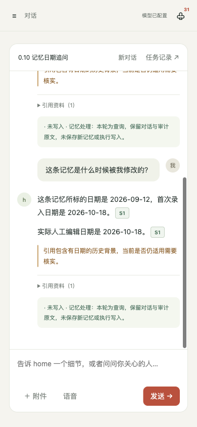
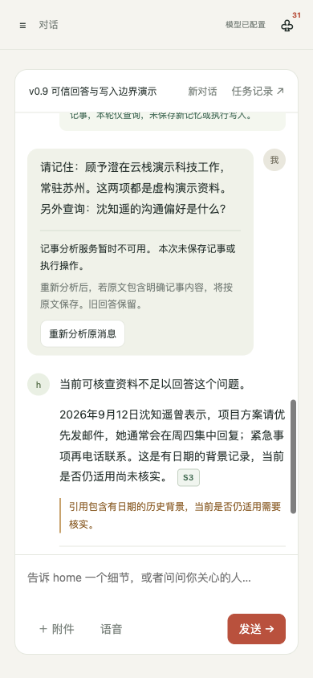

# 0.10 分类、记忆追问与回答稳定性

日期：2026-10-19。开发分支：`home/answer-stability-v010`。0.9 已通过合并提交 `47354f0` 合入并推送 `main`；本轮 0.10 在独立分支交付。

## 改动与依据

[0.9 真实采样](ANSWER_TRUST_V09.md)留下了分类不可用原因无法区分、日期追问未重新读取记忆、修订器否认已确认别名、无依据的冲突解释和重复建议前缀等具体问题。本轮分开处理可确定的后端行为与仍依赖模型的回答质量。

### 分类诊断与明确重新分析

分类器最多发起两次实际请求，每次关闭客户端内部重试；只对可恢复的请求或格式故障追加一次请求。响应为空或被截断时，第二次输出预算由 1800 提升到 3600 tokens；不对语义 unknown、危险原文片段或配置错误反复采样。普通聊天调用的默认参数保持兼容。

用户消息保存安全的失败类别、请求次数、结束原因和用量。类别区分配置/权限、超时、请求故障、空响应、截断、JSON、结构、片段和拒绝；不保存供应商异常正文、请求头或密钥。真实原因不能由旧版笼统的 `classifier_unavailable` 反推。合法但保守的 unknown 与技术故障也分别记录。

已有分类决定、失败决定及损坏的分类元数据继续保守复用，普通重试不会因新一次随机分类而突然获得写入许可。完整记事原话须保留“请记住”等操作前缀、报告归因、条件与否定，不做语义修补。

分类失败或无法判断的用户消息下方提供「重新分析原消息」，说明确认原文包含记事后可能保存。该操作新增关联消息和任务，不覆盖旧决定与旧回答；同一原消息重复请求返回同一任务。已授权写入、已有应用记录、保存或待确认回执的消息拒绝此入口。连续显式分析沿原文哈希追溯最初问题，使用其人物范围和此前历史，不能被后来的其他人物对话带偏。

抽取中的“明天/下周”等相对日期以原消息发送日为日期锚点，普通跨天重试和显式重新分析均保持一致。模型写工具仍沿用既有的明确日历日期守卫，未放宽相对日期工具参数。任务重试以状态、更新时间和事件序号进行原子检查，迟到请求不能覆盖后续一轮任务；同会话活跃任务仍由数据库唯一约束保护。前端已完成的任务重试会创建新的 SSE 连接，并从旧事件游标之后继续读取。

### 记忆日期追问

明确提及“这条记忆/刚才那条记录”等时，系统只查看当前问题之前最近一条终稿，跳过中间工具调用消息。优先使用唯一被引用的记忆；没有引用记忆时，才使用唯一已读记忆依赖。多条记忆必须澄清，不能按编号顺序选一条。`S1` 等编号只属于所在回答，明确指定上一回答编号时仍须重新读库、在本轮重新注册。

绑定保存在用户消息中，包含问题哈希、上一终稿锚点与当时来源快照。重试不改锚点，但重新读取最新记录。人物归档、记忆撤销、删除或转移后拒绝沿用；明确指定新人物或全局范围优先。绑定不是任意代词或任意自然语言问题的完整解析器。

对于严格整句日期问法，例如「这条记忆是什么时候被我修改的？」以及 0.9 的“所标日期还是实际修改时间”问法，使用确定性只读决定与固定日期模板，不调用分类、生成、抽取、工具或回答修订模型。分别给出记忆所标日期、首次录入日期、实际人工编辑日期，以及存在时的撤销/恢复操作日期。人工编辑只来自编辑审计，没有审计则说明未知。

该回答仍必须通过来源预算、引用检查和保存前事务中的来源变化检查。生成期间资料变化会拒绝保存旧答案。超出预算时要求缩小范围，不先注册未提供给模型的资料。其他记忆追问仍进入正常模型流程，不能将日期模板的可靠性推广到所有追问。

### 一次回答修订

修订上下文增加本轮已解析人物的 ID、正式姓名与已确认别名，只含当前人物范围内的人。提示明确禁止因为来源正文未重复别名而否认身份；同时要求删除无依据的工作/私事划分、偏好变化成因和无关背景，不能把这些解释搬到建议或澄清中。

服务端规范化重复的“建议：”前缀。问题审计摘录未逐字匹配草稿时，保留原始 `raw_issues/raw_response` 并标记 `quote_status=unmatched`，规范化问题标签不再伪装为逐字引用；这项审计失败不单独废弃通过正文与来源协议的修订。正文、段落类型和有效来源编号校验继续严格执行。

修订仍最多一次，格式或引用协议失败时保留原稿并告警。`completed` 只表示协议完成，`semantic_verified` 始终为 `false`。提示不能证明建议没有夹带无依据事实，也不能保证所有自然问法都能正确分类或连续取源。

## 验收

自动回归：**1139 项通过**。新增测试覆盖安全诊断与最多两次实际请求、损坏决定只读、前缀裁剪拒绝、显式分析幂等与并发、原消息不变、链式历史范围、实际保存后重试不重复、跨天相对日期、任务事件序号竞争、唯一/歧义记忆、编辑重读、来源不可用和保存前并发变更，以及修订身份上下文与审计协议。测试替身用于验证契约，不计入真实模型回答质量。

应用实现 SHA256：`52897f982c8cdba3022029026c414b17238adbb0902384f86f845750d13bbfc7`。该 hash 覆盖应用与迁移源码；前端、文档、演示库和评测器分别验证。新语料在任何本轮真实请求之前冻结：[answer_stability_v010.json](../eval/fixtures/answer_stability_v010.json)，7 组、12 问，规范化 hash 为 `3639ae99cd21aa190f4d3901cff4b9ca5cba2b6adcc1bd13aa82e284a9033ba1`，正式重复两轮；另对 0.9、0.8 语料各回归一轮。语料是虚构开发资料，不是独立真实用户分布。完整结果与逐轮代理证据审阅分开保留，语义评分仍为待人工审阅。

### 冻结版本的真实结果

三份正式报告均完整结束，运行/场景/执行轮次错误为 0，运行期间应用源码未变化。分类层为 `qwen3.7-flash`，生成与修订层为 `qwen3.7-plus`；评测器 hash 为 `26b6bd7fb23d3816500b382e1892ceaf5d6e97aaf9fe8d61344503240ae513f8`。本轮没有中止或剔除的采样，也没有根据真实结果修改问法或语义提示。浏览器 SSE 和文案修复不改变冻结应用源码。

| 语料与完整报告 | 回答数 | 确定性检查 | 分类与修订观察 |
| --- | --- | --- | --- |
| [0.10 新问法，重复两轮](../eval/results/answer-stability-v010/answers-v010-acceptance.json) | 24 | **308/309** | query 19、record 2、mixed 2、unknown 1；4 轮为确定性日期只读。20 次修订协议完成、4 次确定性回答；1 处问题摘录不匹配保留审计标记 |
| [0.9 原语料回归](../eval/results/answer-stability-v010/answers-v09-regression.json) | 10 | **141/141** | query 8、record 1、mixed 1；1 轮为确定性日期只读。7 次修订完成、1 次确定性回答、2 次修订降级 |
| [0.8 原语料回归](../eval/results/answer-stability-v010/answers-v08-regression.json) | 13 | **213/213**；字符串 **11/11** | 13 轮均模型分类为 query。10 次修订完成、2 次确定性人物澄清、1 次修订降级；资料变化仅新增原文审计证据 |

唯一失败为新语料 `conflict-does-not-imply-private-channel` 第 1 次重复第 1 问：期望 query，实际 unknown/status=invalid。两次分类请求均正常结束（`finish_reason=stop`），但返回内容没有通过 JSON 解析，最终 `failure_category=json`，保守只读；不是网络超时或 token 截断。诊断不保留原始分类响应正文，因此不能进一步断言其具体字符串格式。新语料 CLI 返回 1，如实保留此项失败。

新语料的 **20/20** 实际只读检查、**6/6** 当前字段检查、**24/24** 无伪造引用编号检查通过。两次明确记事均实际保存顾舟青岛，两次 mixed 均实际保存唐宁苏州；后续查询不重复写入。两次唯一记忆日期追问均重新绑定/注册并返回实际人工编辑日期，两次多记忆日期追问均确定性澄清。0.9 回归的 8 项实际只读、4 项字段目标检查也通过。所有来源与人物范围检查未失败，但来源存在不能证明每句话语义得到支持。

47 轮中有 42 轮模型分类、5 轮确定性日期查询，共发起 48 次分类请求。6 轮触发一次追加请求，7 次请求得到 JSON 无效内容，其中 5 轮追加后恢复，1 轮两次均无效后只读。没有观察到配置、超时、HTTP 或截断类失败；这只是本次观察，不能推广为不存在这些故障。与 0.9 记录混合失败码相比，本轮能指出具体失败阶段，但采样数量、问法和重试策略不同，不能据此宣称普遍可用率提升了某个百分比。

回答修订共 37 次协议完成、7 次确定性跳过、3 次不可用。不可用原因为 0.9 回归的 `inconsistent_answer_type`、`inline_reference_not_allowed`，及 0.8 回归的 `invalid_review_response`；均保留原稿与告警。新语料没有修订不可用，也不等于 24 轮语义全部正确。

逐轮代理证据核对见 [完整审阅记录](ANSWER_STABILITY_V010_REVIEW.md)。已经观察到的剩余问题包括：冲突追问“这些记录”未稳定承接人物和重新读取资料；部分回答把记忆类别误当成“不是逐字原话”的依据；“建议：建议直接……”仍可能词语重复；缺资料后附建议时仍会出现保守的缺引用提示。

尤其是 0.8 回归 `correction-withdrawal` 第 2 问，普通偏好查询仍将记忆所标的 **2026-10-09** 称为用户纠正说法的日期，实际编辑审计为 **2026-10-19**；该轮修订完成却没有识别这项错误。`restore-move-archive` 第 2 问还将人工更正证据中的内部 `valid_from` 字段直接带入用户答案；该字段不在记忆来源顶层，日期角色与自然语言表述仍未统一。严格日期追问模板正确，不表示普通问法中的日期表述已解决。提示层加强没有消除这些自然语言问题，保留原始回答供继续回归。独立人工语义评分仍未完成，不将上述计数当作回答准确率。

### 页面与便携演示

浏览器在 1440、390、320 宽度下检查无横向溢出或页面脚本错误。隔离网络替身验证双击、并发分析/发送拦截、丢失响应后再请求、切换对话后的迟到 terminal/queued/SSE 响应，以及已结束任务的普通重试重建 SSE。所有替身只用于前端检查，未调用模型或写入后端数据。

独立演示库通过实际服务完成三轮：沈知遥的联系偏好查询、确定性日期追问，以及 0.9 原分类失败消息的显式重新分析。其中查询与重新分析调用真实网关，日期回答不调用模型。日期回答重新读取同一记忆并区分 2026-09-12 所标日期与 2026-10-18 录入/人工编辑日期，本轮分类请求数为 0。旧失败消息的新分析为 query，因原文明确标注虚构演示而保持只读；重复 HTTP 请求返回同一任务。三轮保留回答、分类和来源审计，模型生成轮另保留修订原稿与终稿，不计入正式评测的回答数。演示回答仍有建议段放入背景状态说明等表述问题，未据此声称已全部解决。





便携快照包含 71 人（66 可见）、220 个字段版本、347 次互动、126 条记忆、69 条承诺、131 笔账目、32 条确认记录、3 个项目、30 个任务（29 完成/1 部分完成）、9 个会话和 47 条存储消息（含 5 条工具消息）。保留原快照的 2627 条应用行，比较时排除会话更新时间及提醒触发状态；旧 41 条消息的原文和元数据逐字保留。预览启动后有 3 条原已到期提醒由调度器正常触发，不是对话新增记事。新快照经独立恢复，通过 SQLite 完整性、外键、3 份附件哈希、410 处指定证据字段关联和 15 份保存引用快照检查。

## 复现

```sh
.venv/bin/python -m pytest tests/ -q --basetemp=.pytest-tmp
node --check web/app.js
.venv/bin/python -m eval.memory_questions --track answers --cases eval/fixtures/answer_stability_v010.json --repeat 2 --output-dir /tmp/home-v010-acceptance
.venv/bin/python -m eval.memory_questions --track answers --cases eval/fixtures/answer_trust_v09.json --output-dir /tmp/home-v010-v09-regression
.venv/bin/python -m eval.memory_questions --track answers --output-dir /tmp/home-v010-v08-regression
```

真实评测逐场景使用隔离进程和临时 SQLite，不打开工作库、不缓存模型输出，embedding 关闭。报告保留配置模型、实现/语料/评测器 hash、失败诊断和源码变化标记；不按较好的回答挑选重复结果。只读检查比较实际领域表变化，但仍沿用既有快照表覆盖范围，不能将其解释为整个数据库不存在任何其他写入。
