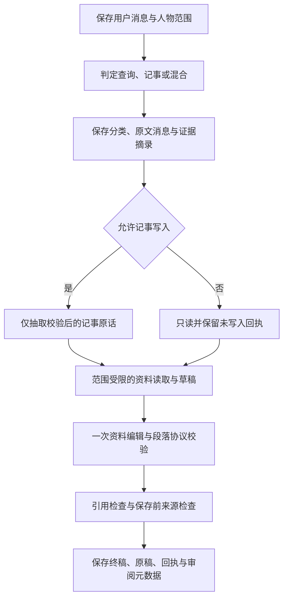
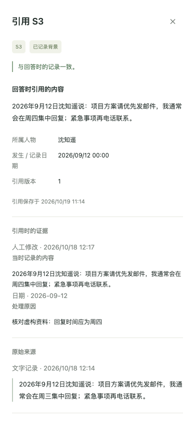

# 0.9 记忆问答可信度

日期：2026-10-19。分支：`home/answer-trust-v09`。0.8 功能提交 `4772a3f` 已通过合并提交 `729dec4` 推送至 `main`。

## 本轮问题与实现

0.8 的真实模型采样发现：来源存在仍可能被误解，例如把已恢复的背景记忆说成已撤销，把生效日期当作用户修改日期，或自行用工作/私事划分调和两条联系偏好。纯查询还可能被抽取成个人意图、问句资料记录或多余身份待确认。这些反例保留在 [0.8 验收](MEMORY_QUALITY_V08.md) 中。

### 查询与记事的写入边界

用户消息先进行一次严格 JSON 意图分类，区分查询、记事、混合与无法判断。记事片段必须逐字出现在原文中，并保留主语、归因、否定及条件；不能从假设、旧回答引文或例句中裁剪出肯定事实。

分类为查询或无法判断时，只保存对话、分类结果和原始审计证据，跳过事实抽取、人物档案、记忆、身份待确认和互动记录的写入。模型随后调用写工具也会被后端拒绝。明确记事与混合消息只允许已校验的记事原话进入抽取及工具写入；完整消息保留在会话，审计证据摘录最多保留 4000 字符，分类决定同时绑定原文哈希。

写工具参数还有独立的后端检查：档案的人物与值、承诺的关联人物与内容、笔记正文、转账的人物与金额及附注，以及提醒的正文和日期、技能名称和正文及可选说明、研究主题、完成承诺的对象与原话，必须在同一个已批准片段中取得依据，不能拼接另一个片段的参数。实际落库也仅使用绑定的片段作为本次写入依据。转账方向复用既有明确措辞匹配以拒绝可判定矛盾；无法识别的自然措辞和承诺的履约方仍沿原抽取置信度与确认规则，不能把参数校验称为语义蕴含证明。完成承诺须明确指向承诺 ID，或以完整承诺原话及不歧义人物定位；不能拿本轮人物选择代替具体完成指令。

日期采用保守规则。固定日期提醒需要原话中唯一、含年份的明确日历日期，暂不将“明天”“11月1日”或条件触发换算成日历日；涉及多个日期时也要求更明确的指令。档案、笔记、承诺和转账工具显式传入的业务日期，同样须与同一批准片段中的人物及内容或金额对应，不能借用查询半句或其他事实的日期。省略日期仍沿用工具原有的系统时间默认，这不表示系统已正确理解任意自然语言业务日期。此限制约束的是这些工具调用，事实抽取及其他入口仍需各自验证。

分类失败保守只读，并显示未写入回执。相同用户消息的重试复用其已保存决定，避免一次失败后再次随机采样变成写入。其他导入入口、人工确认及手动编辑继续使用各自原有管线。

分类本身由模型执行，片段验证无法证明一个句子确为真实断言。后端保证的是已识别的只读决定不能被后续写工具越过；任意自然问法的分类正确性仍需独立审阅。

### 记录状态与时间分开表达

模型所见资料使用明确的“记录状态”“事实时效”“时间信息”，不再使用含混日期或修订号作为说明依据：

| 信息 | 依据与含义 |
| --- | --- |
| 记录可用 | 记忆为 active、未撤销且所属人物可读取；不等于内容当下必然成立 |
| 背景时效 | 有日期的背景记录，事实当前是否仍成立尚未核实；不等于已撤销 |
| 记忆所标日期 | 来自记忆 ts，不作为录入、修改或恢复时间 |
| 最近人工编辑时间 | 只取人工编辑审计的实际时间；没有审计则显示未知 |
| 最近撤销或恢复 | 取对应操作审计，单独表达，不冒充编辑日期 |
| 字段日期 | 分别列出业务生效、结束与系统录入时间 |
| 互动日期 | 分别列出所标发生时间与录入时间 |

保存的完整引用快照继续保留原始字段，旧引用能够继续查看和比较。旧快照未捕获的新补充元信息不会让旧回答虚假变为“已更新”；新快照捕获后的相关变化仍会触发来源变更检查。

### 有来源约束的一次终稿修订

回答草稿生成后，以本轮实际注册资料进行至多一次模型修订。返回的严格 JSON 段落将事实、建议、缺资料、澄清与处理回执分开。事实段必须使用有效的本轮来源编号，由服务器在该段后附引用；建议显示“建议”前缀。

缺资料段落必须提交空正文和空来源，由服务器统一显示“当前可核查资料不足以回答这个问题。”。只有协议校验完成且整条答案类型为 `no_answer` 时，才豁免缺引用告警；建议、澄清、混合答案或修订失败都不能据此关闭告警。建议及澄清仍由模型生成，标签和协议无法证明其中绝无夹带事实。

处理回执段落也必须提交空正文和空来源，服务器只显示“本轮处理结果请以下方回执为准。”。只有本轮实际处理结果中存在成功、待确认或失败项时才允许出现；纯查询的跳过回执不满足条件。模型不能在回执段自由编造写入结果，实际详情由下方结构化回执呈现。

系统验证引用编号、段落协议、预算及 Markdown 中的引用可见性，并保存原稿、修订稿、模型原始 JSON、问题标签与资料哈希。模型格式错误、试图调用工具或引入无效来源时保留原稿并告警，不反复请求修订。原稿中的伪引用告警不会因终稿删除了标记而消失。保存前仍在同一事务中核对所有已读取来源，生成期间变化则要求重试。

`answer_review.status=completed` 只表示协议及来源校验完成；`semantic_verified` 始终为 `false`。修订模型也可能误判事实与建议、漏掉限定条件或提出错误结论；有引用和经过修订都不是语义正确保证。



## 验收与边界

自动回归：**976 项通过**。新增覆盖查询后端写入拒绝、混合片段与原文证据关联、分类失败和重试、条件事实、假设裁剪、操作参数及日期绑定、跨人物片段交叉取值、承诺目标核对、真实编辑日期、旧引用兼容、审阅协议失败及引用遮蔽。测试替身只验证规则，不计为真实模型回答质量。

新增验收语料为 [answer_trust_v09.json](../eval/fixtures/answer_trust_v09.json)：7 组对话、10 个回答，包含恢复后的状态与编辑日期、矛盾联系偏好、无问号查询、假设、旧回答引文、真实更新与查询混合、带问号的明确记事。语料在正式采样前冻结，原始问法不暗中补入人物 ID；不根据采样结果重写问题。它仍是虚构开发验收资料，不是独立真实用户分布。

同一评测器分别运行机械导出的 0.8 与当前实现。实际调用 harness，以及该版本实现的模型分类、抽取、工具和资料修订，不替换成固定回答；0.8 不具备新增的分类和终稿修订阶段。新增只读检查比较实际领域表变化，而非相信模型的 query 标签；明确新事实则检查当前落库字段，不能用“已保存”文本或待确认提案充数。另重跑原 0.8 的 6 组对话，检查既有状态与来源行为。

实际变化快照覆盖 `person`、`person_alias`、`person_field`、`memory_item`、`pending_item`、`interaction`、`interaction_person`、`relation_edge`、`promise`、`ledger_entry`、`reminder`、`applied_patch`、`memory_correction` 和 `evidence` 共 14 张表，逐行比较新增、删除及更新。`evidence` 表的变化会记录，但整体不计入只读失败；因此这一检查本身也不证明新增证据恰好只有原始审计记录。`skill`、`research`、`notification`、项目与任务等表尚不在该快照中，不能将检查通过解释为整个数据库绝无其他写入。对写工具的后端拒绝另有针对性测试。

### 同一新增语料上的 0.8 基线

本节只审阅[本轮正式基线原始报告](../eval/results/answer-trust-v09/answers-v08-baseline.json)，运行编号 `20261019-024001-271752-34070`，使用 0.8 源码哈希 `803855c56033a96cd1abd77e1779f26f54614fb473c3edff2124bb578bb7619c` 和预先冻结的 0.9 语料哈希 `a07e8822b65b84ab15abc65e7466acf1544c69428d41f64c6c2ea9ac434a70ff`。7 组对话、10 个真实回答，运行错误为 0。它与前述历史 0.8 采样是不同运行，不能把历史反例算作本轮又一次复现。

确定性检查为 **128/138**：9 项失败仅表示 0.8 没有 `turn_intent` 元数据，实际值为缺失；另 1 项才是纯查询真实写入领域记录。不能将 10 项失败描述为 10 次误写，也不能将来源检查通过换算成语义准确率。

| 场景与轮次 | 原文、证据与逐轮审阅 |
| --- | --- |
| 恢复记录，第 1 轮 | 回答“能查到”，并以 S2 正确引用“工作联系统一发邮件，急事也先留言，不直接打电话”。数据库记录为未撤销，未误称仍被撤销，也未要求再次恢复。但正文直接输出 `historical_background`、`evidence`、`user_correction` 等内部标签。查询只新增原文证据。 |
| 恢复记录，第 2 轮 | 对日期追问回答“9月11日可能是最初标注的日期，也可能是后来修改它的时间”。本轮人物范围变为无明确人物，没有重新暴露或引用对应记录；实际记忆所标日期为 2025-09-11，编辑动作及对应修订证据在 2026-10-19。回答没有明确断言错误修改日，但未解决日期区分，并保留了未经依据支持的修改时间猜测。没有领域写入。 |
| 矛盾联系习惯 | 两条原话分别正确引用，明确说电话记录没有限定场景，不能判断是私事还是通用习惯。本轮没有擅自断言“私事打电话”。实际问题发生在抽取：纯查询被保存为新记忆“许澄有两条联系习惯，且这两条习惯有点矛盾。”，并生成资料互动、人物关联及应用记录；这条新记忆还作为 S2 再次注入模型。 |
| 无问号查询，第 1 轮 | 正确引用“工作联系先发短信，收到后再约通话”，未新增个人意图或其他领域记录。 |
| 无问号查询，第 2 轮 | 对花生过敏问题正确说明没有唐宁的记录，未引用顾舟的饮食资料，也未写入领域记录；但固定引用要求使缺资料回答出现 `uncited` 告警。 |
| 假设更新城市 | 未把假设中的北京写入，档案仍为天津，并引用 S1。正文给未来更新建议，但暴露了 `save_person_fact`、`city` 等实现名称。 |
| 旧回答引文 | 没有保存引文里的“喜欢花生”，按 S2 原文纠正为不吃花生、口味清淡；没有进一步推断过敏。 |
| 真实更新与查询混合，第 1 轮 | 苏州字段真实落库、南京字段结束，新增的事实记忆仅为“唐宁搬到苏州了”，没有查询半句的意图记忆；成功回执有实际写入支持，联系偏好引用 S4。但“这条信息是去年9月左右记录的”将记忆所标的 2025 年 9 月说成录入日期，实际录入时间为 2026-10-19。 |
| 真实更新与查询混合，第 2 轮 | 本轮已读取当前苏州及历史南京，回答结论与档案一致；整条未附引用并出现 `uncited` 告警，没有领域写入。 |
| 带问号的明确记事 | 青岛实际落库、天津结束，成功回执真实。正文额外提及的饮食偏好有 S4；城市与历史城市句没有就近引用。饮食提醒也超出了本次记事问题。 |

这 10 个回答中，已注册来源快照及人物范围检查通过，未发现伪造来源编号或跨人引用。上述审阅是具体证据核对，不是独立人工评分；语义评分仍保持待审阅状态。混合更新和明确记事的实际成功也须保留，不能仅报告基线失败。

### 0.9 正式新增语料结果与逐轮对照

[正式原始报告](../eval/results/answer-trust-v09/answers-v09-acceptance.json)的运行编号为 `20261019-030853-433633-36176`，状态为 `complete`。7 组对话重复 2 次，共 14 个场景实例、20 个回答；应用 SHA256 为 `648e46e7a87a80615c2ca4dca85ac0a0300b258610285c255d6634eccac1939e`，沿用前述冻结语料及评测器，运行期间应用源码未变。

| 检查 | 正式观察及含义 |
| --- | --- |
| 运行 | 运行错误、场景错误及执行失败轮次均为 0；分类或修订的保守降级另行记录，不被这项统计隐藏 |
| 确定性检查 | **266/272**，CLI 返回 1；6 个失败全部为期望 query 而分类结果为 unknown |
| 分类 | query 10 个、mixed 2 个、record 2 个、unknown 6 个。6 个 unknown 的状态均为 failed，原因均为 `classifier_unavailable`；现有记录不能再细分为服务商、网络、JSON 或其他具体原因，不能将其说成模型判定应当记事 |
| 实际只读 | 16/16 项只读变化检查通过，含上述保守降级的查询；在前述快照覆盖范围内仅新增原文审计证据，未复现基线将联系习惯查询保存为新记忆的问题 |
| 实际字段 | 8/8 项当前字段目标检查通过。两次混合消息均保存苏州、结束南京，两次带问号的明确记事均保存青岛、结束天津；没有因问号或纯查询保护而丢弃这四次真实更新 |
| 来源 | 20/20 项无伪造引用编号检查通过，来源快照和人物范围检查未失败；这不能证明引用支持所有句子 |
| 终稿修订 | 19 个 completed、1 个 unavailable。不可用项为旧回答引文场景的第 2 次重复，原因是 `invalid_issue_quote`，保留原稿并显示资料核对未完成告警；completed 同样不代表语义正确 |

下表逐个问题对照两次正式重复及上节基线，不混入中止版本的观察：

| 场景与轮次 | 两次正式回答的证据与剩余问题 |
| --- | --- |
| 恢复记录，第 1 轮 | 两次均正确引用保存的邮件原话，并说明记录已恢复、可读取且未撤销，未再输出内部状态标签。第 1 次修订却新增“资料中未找到名为‘糖糖’的人物，仅有‘唐宁’”的澄清；冻结语料明确将糖糖设为唐宁别名，人物解析也已成功。这是修订引入的错误否认，不能因来源检查通过而忽略。第 2 次没有这项多余澄清。 |
| 恢复记录，第 2 轮 | 两次本轮人物范围均为 none，没有调用读取工具、也没有重新提供该记忆来源，最终均输出固定资料不足说明，未完成用户想核对的实际编辑日期。第 1 次草稿还编造了“2026-09-11 10:23:45”录入时间，终稿将它删除；第 2 次也删除了没有本轮来源的说明。因此改进是避免未经核实的回答，不是已经解决日期追问。 |
| 矛盾联系习惯 | 两次均分别引用邮件及电话原文，并承认不能确认工作/私事划分；实际查询没有写成新记忆。第 1 次修订删除了草稿中的场景调和及“较新日期代表改主意”推测。第 2 次仍在建议段保留“项目事项走邮件，非项目急事在周三午休打电话”及偏好可能变化的解释。它标明可能，并未断言真实私事偏好，但仍不是资料提供的适用范围，说明修订未稳定消除无依据的冲突解释。 |
| 无问号查询，第 1 轮 | 两次均正确引用短信后再约通话的原话，将 2025-09-11 称为所标日期，并区分偏好当前是否仍成立；无个人意图或其他领域误写。 |
| 无问号查询，第 2 轮 | 两次均使用固定资料不足说明，没有借用顾舟的不吃花生记录推断唐宁过敏，也没有多余 `uncited` 告警。第 2 次分类不可用后仍保持只读。 |
| 假设更新城市 | 两次均保留天津，未将假设中的北京写入；天津事实有来源，更新建议单列。第 1 次最终仍问“是否需要现在执行更新操作”，尽管用户明确说只是假设，属于多余的操作确认。 |
| 旧回答引文 | 两次都未把“喜欢花生”引文保存为新偏好，饮食事实引用的是不吃花生、口味清淡的原文，未扩展为医学过敏诊断。第 2 次修订因引用草稿片段不合法而整体降级，正文沿用原稿及其有效引用，告警如实保留。 |
| 真实更新与查询混合，第 1 轮 | 两次分类均只批准“唐宁现在搬到苏州了。”，实际字段和事实记忆支持更新，查询半句没有生成意图记忆；联系偏好有 S4。第 1 次终稿删除了“搬家可能导致联系习惯变化”的无据推论。第 2 次建议段仍写“该记录时间为2025年9月”，而资料实际首次录入在 2026-10-19，记忆所标日期才是 2025 年 9 月；“记录时间”的含混表述仍可能使两种日期混淆。 |
| 真实更新与查询混合，第 2 轮 | 两次均重新依据本轮当前字段回答苏州并附 S1，第 2 次还以 S2 说明南京记录已结束；基线整条漏引的问题在这两次没有复现。 |
| 带问号的明确记事 | 两次均真实保存青岛，城市事实有本轮来源，写入处理使用固定回执提示。第 1 次还引用历史天津，第 2 次仅给当前青岛；均没有基线额外插入的饮食提醒。 |

仍有多处“建议：建议：”重复前缀，以及建议或澄清段保留未经来源支持的解释。段落类型标签不能替代语义核对；终稿编辑也可能删除幻觉、引入错误，或因协议错误保留原稿。人工语义评分继续为 `review_pending`，以上为逐轮代理证据审阅，不提供语义准确率，也不把 266/272 当作回答正确率。

### 运行纪律

正式语料冻结后，独立规则审计先后复现了操作参数跨片段拼接、回执正文可编造，以及未显式带日期的普通档案写入仍可交叉取值的漏洞。例如“林舟住杭州。陈宁住上海。”不能授权把林舟的城市写成上海。两次审计前采样均在尚未完成时中止，保留原始中间报告；补修确定性边界并完成回归后，使用新输出目录重新取样。中止报告状态为 `running`，不计入最终结果，也不与最终版本拼接。补修依据是可复现的后端参数和协议问题，没有按新语料的较好回答挑选样本；新语料及语义提示词未因这些取样改写。

审计前第二次运行实现 SHA256 为 `30437672b5bdb8b9727a33f21858f04ff202831424efc9b3b4589ca2efe40520`，不作为最终验收版本。评测器 SHA256 为 `ff1670ba57a39ba001916d6d6e43b6519cc860f22082c29bbcaf5cba8d0db1a2`；配置的分类层为 `qwen3.7-flash`，生成和修订层为 `qwen3.7-plus`。源码哈希覆盖应用与迁移代码；前端回执展示的修补不改变该哈希。

最终冻结实现 SHA256 为 `648e46e7a87a80615c2ca4dca85ac0a0300b258610285c255d6634eccac1939e`。分类器及语义提示词保持不变。另做过一次独立可用性诊断，模型正常返回 JSON，但裁去操作前缀的片段被严格校验拒绝；这一诊断不计入正式回答数量，也不能解释之前所有 `classifier_unavailable` 的原因。当前这一失败码合并请求及解析异常，不能将它单独归因为网络、权限、格式或分类语义错误。

### 原 0.8 语料回归

[原始回归报告](../eval/results/answer-trust-v09/answers-v09-regression.json) 在最终实现 `648e46e7` 上完成 6 组、13 轮真实回答，运行错误为 0；**218/218** 项确定性检查、**11/11** 项有限字符串检查通过，运行期间源码未变化。计数验证资料、人物范围及状态等明确契约，不表示 13 轮语义全部正确，原始报告的语义评分仍为空。

分类结果为 8 轮查询、5 轮无法判断，其中 4 轮因分类阶段不可用降级，1 轮被模型保守判为上下文不足。所有轮次均禁止写入，被快照覆盖的领域表无新增或修改，仅新增 13 条审计证据。11 轮完成一次终稿协议检查，另 2 轮使用确定性澄清。本语料没有操作工具回执，不能据此评价真实写操作回执的全部行为。

昵称与代词承接、同名公司选择、当前与历史居住字段、更正与撤销、恢复、移动及人物归档均按本次资料变化处理。移动后的何川同时存在午休电话和工作邮件两条记录，回答展示冲突并要求核实，没有自行创造工作与私事划分；归档后未重新创建同名人物。

仍保留明确反例：`correction-withdrawal` 第 2 问把 2026-10-09 的记忆标注日期说成“纠正过之前说法”的日期，而可核验人工编辑时间是 2026-10-19；血型缺资料回答仍追加城市、培训、羽毛球等无关已知资料；若干建议出现重复“建议：建议：”前缀。时间语义、资料选择及表述质量仍需改进，有有效引用及终稿修订均不能替代逐句核对。

### 页面与便携演示

最终应用在独立演示库验证桌面 1440、手机 390 / 320 宽度，无横向溢出；引用弹窗可读取原始来源和人工修改，未提供编辑控件。前端另以 11 项隔离数据检查提醒、完成承诺、技能、研究等工具回执的成功、待确认、失败、跳过和去重，读取工具不会显示为保存成功。这些展示检查不计入真实模型回答数量。

六轮真实网关演示保留全部原稿与元数据。审计前四轮包含正确引用、缺资料及分类不可用时只读；最终版先验证明确“虚构演示”声明按规则只读，再用不带假设声明的自然事实句验证混合消息：顾予澄的公司“澄川设计”和城市“厦门”真实保存，资料互动只含事实句，查询沈知遥偏好的半句没有成为新记忆或待确认。演示回答仍保留重复“建议：”等表述问题。流式阶段会先呈现草稿，完成核对后替换为终稿，不能将流式文字视为已通过资料核对。




[便携演示快照](../demo/README.md) 包含 71 人、220 个字段版本、347 次互动、126 条记忆、8 个会话及 41 条存储消息。旧快照的 2394 条应用数据和 24 条消息的原文与元数据逐行保留。实际从新快照恢复独立数据库，SQLite 完整性、外键、3 份附件哈希、422 处证据引用及已保存来源快照检查通过；演示恢复测试 5 项通过。控制台仅观察到 favicon 404，未见应用脚本异常。

## 复现

```sh
.venv/bin/python -m pytest tests/ -q --basetemp=.pytest-tmp
.venv/bin/python -m eval.memory_questions --track answers --cases eval/fixtures/answer_trust_v09.json --repeat 2 --output-dir /tmp/home-v09-acceptance
.venv/bin/python -m eval.memory_questions --track answers --output-dir /tmp/home-v08-regression
```

真实回答会调用配置的模型并增加分类、修订阶段的延迟和费用。场景及重复使用独立进程和临时数据库；不打开用户工作库，不缓存模型输出。完整结果保留实现、语料和评测器 hash、配置模型层级及运行期间源码变化标记。未配置 embedding，本轮不声称改善向量或无词面重合的检索质量。
