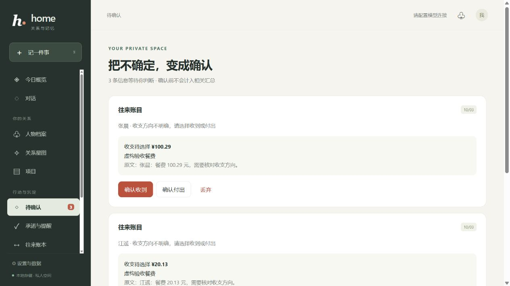
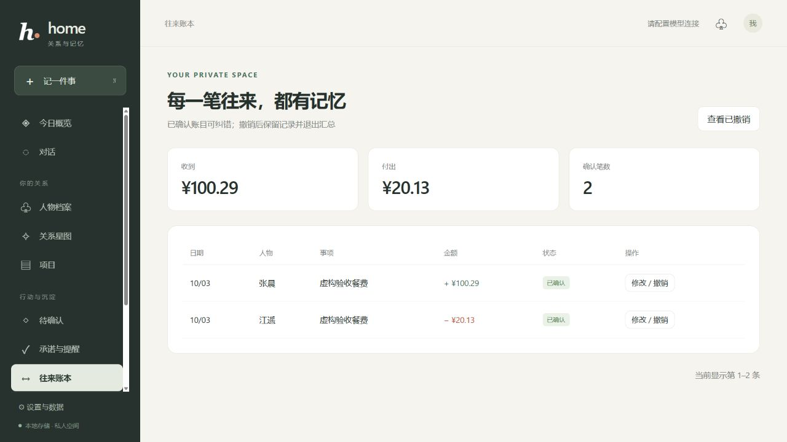

# home 交付与验收

## 0.14 交付登记（2026 年 10 月 21 日）

当前应用版本为 **0.14.0**。本次向主分支交付从 0.11 之后积累的 0.12、0.13 和 0.14 实现、控制测试、真实模型原始结果及逐步审阅；0.14 首次实现提交为 `929cbe6`，补修与最终验收提交为 `6733db9`。各版本记录自己的采样实现，不能把历史结果合并成最终版本的全量通过率。

| 版本 | 交付行为 | 详细依据 |
| --- | --- | --- |
| 0.12 | 同人物多条记忆追问、集合与日期绑定、来源变更后的重新核对 | [实现与验收](MEMORY_DIALOGUE_V012.md)、[原始结果与旁注](../eval/results/memory-dialogue-v012/README.md) |
| 0.13 | 服务端按真实资料展示来源，最多一次结构化资料编辑；已写入后允许只读重建回答，保留独立回执并防止重复保存 | [实现与验收](ANSWER_EVIDENCE_V013.md)、[原始结果与旁注](../eval/results/answer-evidence-v013/README.md) |
| 0.14 | 按原文称呼逐条绑定已选人物，复验别名归属，限制称呼推断及单位边界；明确草稿正文、口语命令和连续改稿的人物范围 | [实现与验收](WRITE_QUALITY_V014.md)、[原始结果与旁注](../eval/results/write-quality-v014/README.md) |

0.14 最终实现的离线验证为 **1752 项 Python 测试、6 项 Node 重试界面测试通过**，`node --check web/app.js` 通过。首次真实模型采样为 18 步、机器检查 **298/301**；补修后仅对三个首次失败场景的原有全部 6 步采样一次，机器检查 **94/94**、无运行异常。两次实现 hash 不同，结果分列；最终实现未再次采样首次全部 18 步。配置使用 `qwen3.7-flash` 与 `qwen3.7-plus`，所有场景使用独立临时 SQLite，不修改用户工作数据库。

机器检查不等于语义准确率。定向回归已恢复实际城市保存、邮件正文和改稿人物承接，但代词抽取仍可能为空，实际补存依赖后续工具；草稿仍出现先询价后补规格、弱化样张通过后再排产条件的偏差。原始失败、原始 null 语义评分与逐步旁注均保留，生成结果保持 `semantic_verified=false`，使用草稿前仍需核对正文条件。归档文件的完整性记录见 [0.14 manifest](../eval/results/write-quality-v014/manifest.json)。

本次交付不新增数据库迁移，也不自动重抽或改写已有资料。演示数据恢复方法仍见[演示说明](../demo/README.md)，服务按需由用户启动；0.14 验收未启动 Web 服务。[项目介绍 PPT](presentations/home-project-introduction-v0.14-20261022.pptx)已于 2026 年 10 月 22 日整理为 0.14 版，共 56 页，包含新增架构、写入与改稿流程、分阶段验证和已知限制；保留原有产品图并标注历史截图，0.11 介绍文件继续留档。

## 0.2 历史交付（2026 年 10 月 1–3 日）

以下内容保留 0.2 当时的交付与验证语境，其中测试数量、运行环境和模型结果均为历史记录。

2026 年 10 月 1 日完成主要实现，10 月 2 日整理提交文档，10 月 3 日补充抽取与收支校验。实现基于起始提交 `813f1ff`；评测文件中的 Git SHA 表示采样时的 HEAD，不代表后续实现的版本。

这次交付把原型补成可以日常使用的本地关系工作台，接通用户提供的 API 网关，完成首页、流式对话、摄入与任务、来源历史、待确认、承诺账本、技能、项目、星图、研究和备份。功能范围及使用方式见 [README](../README.md)。修改前的问题记录保留在 [初始审查](PROJECT_AUDIT.md)。

## 验证结果

**254 项自动测试通过**（10 月 2 日提交时为 209 项）。在 Windows 的 `.venv` 中运行 `python -m pytest -q`；前端通过 `node --check web/app.js`，Python 模块通过编译检查。

新增回归覆盖了以下具体故障：

- 工具与抽取重复写同一笔资金；同名别名被默认绑定到第一个人。
- 低置信记忆没有确认入口，账目确认重复插入、丢弃仍留在 pending 状态。
- 待确认承诺确认后不建提醒，完成承诺后提醒继续存在。
- 冷启动没有会话、同轮用户消息重复注入、保存失败没有持久回执。
- 最新消息窗口顺序错误，超过 500 条后历史摘要停滞。
- 缺少真实来源的高置信字段直接入库；历史日期改写当前字段。
- 归档后的互动、账本和提醒仍进入普通检索与汇总；清除后的独占互动残留。
- 长任务只同步等待，失败无法重试，刷新丢失状态；同一会话并发任务竞态。
- 丢弃过的同一来源在任务重试时再次进入待确认。
- 研究审查没有原文、接受未抓取链接、原文被翻译后无法核验。
- JSON 解析破坏字符串中的中文引号、冒号和字面尾逗号。
- 单独出现的亲属称谓被自动当作实名人物。

## 真实网关与浏览器验收

所有人物与往来均为虚构测试数据，使用独立的 `data/qa/app.db`，没有写入正式 `data/home.db`。

| 流程 | 实际结果 |
| --- | --- |
| 网关兼容 | 验证模型清单、非流式 JSON、真实工具调用与视觉输入；非流式请求显式关闭 SSE |
| 首次记录 | 输入林舟的公司、职位、100 元礼金、10 月 7 日方案承诺；建立档案、1 笔 100 元账目、承诺与提醒，显示逐条回执 |
| 字段来源 | 浏览器人物抽屉展示原始陈述、字段生效时间和历史查询；原始截图附件可下载 |
| 聊天记录 | 上传三条虚构聊天，指定「我」；提取陈岚的公司、设计师职位、苏州城市与 10 月 9 日承诺 |
| 截图 | 上传含虚构聊天的 PNG；准确转写许晴的南京、实验室、研究员信息，生成 10 月 12 日承诺与 200 元账目 |
| 待确认 | 丢弃待确认城市，确认 35 元餐费；队列清空，全局支出从 300 元变为 335 元，共 3 笔，没有重复计账 |
| 刷新恢复 | 在查询三个人物的任务运行时立刻刷新；恢复处理中状态，最终渲染三张表；该会话只保留 1 条用户消息和 1 条最终回答 |
| 项目与技能 | 浏览器创建含成员的项目并保存沟通技能，保存后重新读取成功 |
| 研究 | 生成贴近官网内容的三方向提案，确认后执行；得到带链接的报告和 7 条原文证据，仅引用 `https://marsdata.ai` |
| 前端 | 检查桌面布局与窄屏导航，浏览器无观察到的错误日志；Markdown 内容经过本地 DOMPurify 清理 |
| 关系日志 | 基于当日互动以及结构化承诺、账目生成，明确保留日期和金额；不把系统省略号当成对话中断 |
| 备份 | SQLite backup 生成快照，ZIP 包含数据库和附件；自动测试确认不包含 `.env` |

研究验收过程中发现搜索服务会返回无关的 Facebook 页面，已改为在指定公开 URL 的情况下只接受相应域名。提案先阅读原文；审查选择提供的原文片段编号，由代码回填实际原文，避免翻译或改写引文。报告明确区分官网自述与低置信推断。本次官网研究只有一个来源，不能据此认定 Mars 登录后的产品或技术架构已经独立核实。

## 字段与账目纠错验收

人物档案的每个当前字段提供修改与纠错入口。删除结束当前版本，历史仍可查询；转移结束原人物的当前版本，在接收人物新增版本并保留原始证据。目标人物已有同类字段时，必须勾选替换。历史恢复新增当前版本，不覆盖过去版本，也不抹掉删除至恢复之间的空档。

账本允许修改已确认账目的关联人物、收支方向、金额、日期与事项。撤销后账目退出汇总，可通过「查看已撤销」查阅原始凭证与修改前后记录。修改保留原始去重键，来源重放不会恢复旧金额或重新计账。页面提交字段版本或账目修订号；旧页面提交冲突时返回提示，要求重新读取。

本轮新增 16 项自动回归，包括旧数据库升级、删除恢复、证据保留、转移冲突、归档目标拒绝、账目金额与日期校验、汇总更新、来源重放、合并拆分后的纠错记录，以及转移写入失败时双方回滚。所有写入与审计记录在同一事务中提交。

浏览器使用独立的 `data/qa/corrections.db` 和虚构人物验收：城市删除后从历史恢复；公司转移时明确确认替换目标旧公司；将 100 元支出更正为另一人物的 35.67 元收款，汇总同步变化；撤销后汇总归零，原始来源与两次修改记录仍可查阅。验收数据没有写入正式数据库。

这些纠错是用户手动决定，不代表模型抽取召回已经提高。删除字段保留历史与原始内容，转移字段也不会改写过去的原文或已生成对话。

## 批量模拟数据复测

新增独立模拟库，最终含 66 位人物、208 条字段版本、341 次互动、71 条承诺、131 笔账目与 27 条待确认。通过真实模型抽取、对话、视觉和群聊导入复测，修复跨入口收支方向冲突、日期前缀承诺重复、操作要求误入记忆、同名展示、账本分页与星图拥挤。两轮抽取的 82 个明确字段匹配从 81 个变为 82 个；这些合成样本不替代下文 holdout 结果。原始结果、页面截图和复现命令见 [批量模拟数据验收](MOCK_QA.md)。

## 新模型抽取评测

使用 `deepseek-v4-flash`，关闭缓存，30 条 holdout 用例各采样 1 次。两次完整运行分别通过 29/30 与 28/30；最新完整评测见 [JSON 结果](../eval/results/20261001-123305-813f1ff.json)。

| 指标 | 最新完整运行 |
| --- | --- |
| 用例通过率 | 0.9333 |
| 字段召回 | 0.75 |
| 承诺召回 | 1.0 |
| 证据命中 | 1.0 |
| 承诺误报率 | 0.0 |

最新运行漏抽了一个公司字段，并把单独的「妈妈」抽成人物。后一个问题随后修复了统一角色过滤，新增六种亲属称谓的确定性回归验证通过；没有把这次修复换算成未实际测量的全量模型分数。每次仅采样一次，不代表多次采样稳定性或真实用户数据准确率。字段漏抽仍是已知模型局限，不能用测试总数替代抽取准确性。

## 2026-10-03 抽取与收支校验

修复了三个确定性问题：缺失方向被默认记作支出；非有限金额让整批抽取报错；`NaN` 置信度被夹成 1.0。新增 [45 项回归](../tests/test_extraction_validation.py)，覆盖异常数值、精确分币、畸形结构、抽取与工具一致性、方向确认、跨天重放、重复账目和已撤销账目保护。

方向不明的账目只进入待确认。用户必须选择收到或付出才能入账，原文可见；选择缺失或非法时 API 拒绝请求，待确认状态保持不变。确认使用普通资金事件去重键，已存在的同一笔账目不会再增加金额；已撤销记录不会通过这个入口重新计入。来源确认与丢弃记录均保留，跨天重放也不重新生成待办；同一事件的后续抽取补上或改变方向时，仍保留既有人工选择、丢弃结果或待处理状态。

金额使用 Decimal 校验，不接受布尔值、非有限值、非正数、超过范围或包含不足一分的尾数，不做隐式四舍五入。金额异常不会连带丢掉同批有效字段。显式异常置信度按 0 处理，缺失值沿用既有默认值；对象类型字段值与畸形集合被跳过。

浏览器使用独立的 `data/qa/validation-20261003-8c6393c6` 验收三个虚构账目：确认张晨收到 100.29 元、江遥付出 20.13 元，丢弃林舟 60.27 元；最终队列清空，汇总为收到 100.29 元、付出 20.13 元，共 2 笔。观察到的浏览器警告与错误日志为空，正式库没有写入这些测试记录。

修改后对已有 `holdout.jsonl` 的 30 条样本各做一次无缓存真实调用，通过 29/30，字段召回 0.75、承诺召回 1.0、证据命中 1.0、承诺误报率 0.0。唯一失败仍是 `hold3-p01` 漏抽公司字段。结果见 [原始 JSON](../eval/results/20261003-130302-a2a33e1.json)，其中 `a2a33e1` 是执行时尚未提交修复的 HEAD。这个结果是已有样本的复测，不作为全新留出集的泛化证明。

## 运行与数据边界

正式工作台在 <http://127.0.0.1:8000>，启动脚本为 `run.ps1`。服务保持运行才能发出到期提醒。API 密钥保存在忽略文件 `.env`；备份与浏览器配置接口均不返回密钥。

外部 IM 账号、云浏览器、录音 ASR 和视频分析未接入；星图使用 SVG 立体投影。网页抓取不支持登录和仅脚本渲染页面。文档与聊天记录解析有明确上限。自动抽取、沟通建议、检索及研究的语义正确性仍需用户判断。

归档和清除的具体范围见 README：过去对话、生成日志、任务回执及共享原文不会自动匿名化。这里不承诺完全离线推理、完整复制 Mars 的未公开产品，或清除人物后全部历史文本都不存在。
