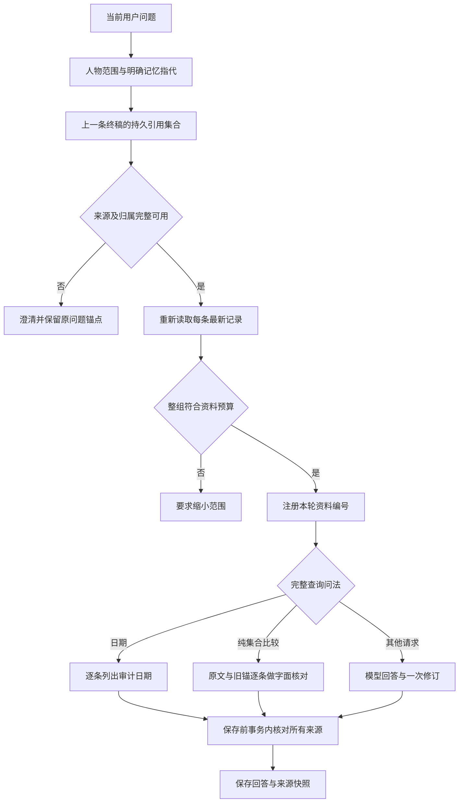

# 0.12 多轮记忆追问与证据比较

日期：2026-10-20。应用版本：0.12.0。分支：`home/memory-dialogue-v012`。

## 产品行为

先查询同一人物的两条记忆，再追问「这些记录有什么差异？」或「刚才两条现在怎么写的？」，系统从上一条终稿的实际引用确定完整集合，本轮重新读取所有记忆、分配新的资料编号。编辑后的内容来自最新记录，原问题的引用锚点保留；重试不会改用后来的回答或另一段对话。

集合成员只能属于同一个人物，或全部为个人记忆。两条后的单数「这条」、多人物集合、条数对不上、混有字段或互动来源的模糊集合均先澄清。用户明确指定上一回答中的多个资料编号时，可核对对应的记忆子集。明确换人物或全局范围优先，不沿用旧人物的引用。

任一成员撤销、删除、归档或转移后，整组要求重新确认，不静默删掉失效项继续比较，也不展示转移后的新人物。普通内容编辑则重新读源。整组紧凑资料超过预算时不注册任何成员；保存回答前在同一事务内检查全部已用来源，生成期间变化会拒绝保存旧答案。



## 日期与文字依据

支持的完整日期问法包括「这条是什么时候记下的？」「这条记忆是什么时候被我修改的？」及「这两条是什么时候记下的，后来又是哪天改过？」。模板逐条列出记忆所标日期、首次录入日期、最近一次实际人工编辑日期及存在时最近一次撤销/恢复操作的日期。人工编辑时间只取纠错审计，不从记录日期、更新时间或版本推断。没有审计则说明未知。只有完整匹配的查询才采用只读日期模板，追加记事、修改或恢复指令继续走正常意图判断。

普通回答与修订使用自然语言时间投影和文字核对说明。记忆分类不再进入模型资料投影；人工纠错和确认提案的内部 JSON 键不直接提供给模型。完整原始快照与审计仍保留在来源中。逐字一致仅指系统保存的文字，不证明当事人逐字说过，也不能据分类断言「并非原话」。

完整的纯集合比较问法，例如「这些记录有什么区别？」或「刚才两条现在再对照一下，原文和能支持的结论有没有变化？」，在意图明确为只读查询时采用服务端文字对照：逐条列出当前保存文字、日期角色，并按记忆身份与旧锚快照比较，标明「保存文字已变化／未变化」。日期或恢复版本变化但正文不变时，不报文字变化。此模式不生成共同动机、工作/私事划分或偏好替代结论，也不声称提供逐词差异或语义矛盾判断。它只复制前 1600 字符并说明截断；含有引用标记或会影响引用显示的格式时，保留来源入口，请用户打开完整记录。

识别采用完整问句语法，未识别的分句、起草、建议或附带记事继续走原流程；不会因为包含「这些记录」就丢掉其余任务。比较仍先经过实际意图分类，分类无法确定时不把模板当作分类成功。unknown 或分类失败时，服务端在修订后固定保留未写入原因和实际状态，单独保存 `intent_notice`；模型改成「资料不足」也不能抹去记事未保存的说明。

修订协议增加可选的 `source_quote` 段，由服务端从本轮已注册快照填入记录文字，限制为前 1600 字符并在截断时说明。段落不能自行提供正文，只能选择一个有效编号；可能制造或隐藏引用的文字会拒绝这次修订并按原有流程告警。其他事实解释仍由模型生成，一次修订通过不表示语义正确，`semantic_verified` 保持 `false`。

查询、未知意图和记事片段的写入边界继续独立判断。新增简写不会把「记住：这条是我每天回家的路线」等普通记事变成缺失记忆澄清；混合消息仍只把真实记事片段交给抽取，不能用焦点绑定授权保存查询内容。

## 自动回归与交叉审查

`.venv/bin/python -m pytest tests -q`：**1283 passed，11.99s**。包括集合精确身份、旧单条绑定兼容、旧锚重试、明确换人、成员撤销/转移/归档、完整预算、生成期间变更、单数歧义、日期只读、纯集合文字比较、复合任务保护、危险引用显示、分类失败通知及真实记事保存。语法编译与 `git diff --check` 通过。

交叉审查发现并修复了两项问题：简写误拦截普通记事，以及评测器只验证锚点身份而没有验证旧文字。新增负控现在会拒绝伪造锚点、旧快照正文、revision、跨对话或后置锚点；即使同步伪造当前回答和用户元数据，也必须与数据库中的实际前序终稿逐字一致。

## 冻结语料与真实采样

新语料为 [memory_dialogue_v012.json](../eval/fixtures/memory_dialogue_v012.json)，8 组、每轮 20 答，包含集合对照、编辑、撤销、转移、日期、恢复、明确换人、同名、多人物集合、单数歧义、明确记事与混合消息。新问法在模型采样前冻结，后续没有按回答改题。日期和断言在采样前做过静态校对。

- 规范化语料 SHA256：`31156596f125bbf920f1d347ce8b3a374c492d6f3952ca13e6862142922891d5`
- 语料文件 SHA256：`adaf693b79fb4332f9a6bf9abc684800901dcf7f93d29bc8337b6c816de57aac`
- 最终应用实现 SHA256：`03a19327124586cfb40c73ca246084b8a3ff91716b2437e170928186a5d3baf3`
- 评测器 SHA256：`0cab27da2a00ae850c9f1bfd8f9429a28f8ba021945a8f3e98d05d3d7265190c`

真实采样采用相同冻结实现和语料的三个独立 CLI 运行，每份报告 `repeat=1`，合计重复三次。每个场景使用独立进程、临时 SQLite 和附件目录；保留完整原稿、修订、工具、来源、分类与实际领域变化。模型层级为分类 `qwen3.7-flash`、回答及修订 `qwen3.7-plus`；不启用 embedding 或缓存，不打开本机用户工作数据库。

在最终实现前，完成过三次首版运行（应用 SHA256 `cf2a6a85239e883adcd33e8c921e0e3bfcc0c73799a62411363669f3737c4b7f`），共 60 答：检查分别为 **484/485、470/472、493/493**。失败包括一次查询分类降为 unknown，以及一次显式记事分类失败、厦门未落库。逐句核对还发现取源正确但解释补出「项目/非项目」、共同心理目的、未记录的适用条件；一次编辑又将记事失败改成无资料。它们促成本轮确定性文字对照和服务端失败通知，原始报告与代理审阅全部保留在 [development-baseline](../eval/results/memory-dialogue-v012/development-baseline/)。因此最终采样是同一开发语料上的复验，不能称为独立未见语义基准。

更早开发期因静态发现单数简写遗漏而中止过不完整采样，工作记录保留在本机 `data/qa/memory-dialogue-v012/`，不计入上述首版或最终结果。

## 最终采样结果

最终五份回答报告共 **85 答**，全部运行完成，无运行错误、场景超时或运行期间源码变化。每份都是单独 CLI 的 `repeat=1`。三份新语料合计重复三次；另外两份分别回归旧语料，不能将85答说成同一套问法的重复采样。

| 语料与运行 | 回答数 | 确定性检查 | 证据记录 |
| --- | --- | --- | --- |
| 0.12 run-1 | 20 | 483/483 | [原始报告](../eval/results/memory-dialogue-v012/acceptance-run-1.json) · [逐答核对](../eval/results/memory-dialogue-v012/acceptance-run-1-evidence-review.md) |
| 0.12 run-2 | 20 | 482/483 | [原始报告](../eval/results/memory-dialogue-v012/acceptance-run-2.json) · [逐答核对](../eval/results/memory-dialogue-v012/acceptance-run-2-evidence-review.md) |
| 0.12 run-3 | 20 | 470/470 | [原始报告](../eval/results/memory-dialogue-v012/acceptance-run-3.json) · [逐答核对](../eval/results/memory-dialogue-v012/acceptance-run-3-evidence-review.md) |
| 0.10 回归 | 12 | 223/223 | [原始报告](../eval/results/memory-dialogue-v012/regression-v010.json) · [核对](../eval/results/memory-dialogue-v012/regression-evidence-review.md) |
| 0.8 回归 | 13 | 283/283 | [原始报告](../eval/results/memory-dialogue-v012/regression-v08.json) · [核对](../eval/results/memory-dialogue-v012/regression-evidence-review.md) |

0.12 唯一失败是 run-2 集合比较第2答：分类器两次 JSON 无效后降为 unknown，不能算分类成功。该轮未启用要求 query 的文字比较模板，仍经生成与修订回答；实际只读，服务端稳定保留格式失败及未写入说明。其余5次纯集合比较进入确定性文字模板，9次日期追问进入日期模板，逐答核对未发现对应原文、字面变化或日期角色错误。没有通过重跑筛掉这份失败报告。

三份新语料的实际已读依赖要求 **69/69**、最终引用要求 **69/69**、集合绑定要求 **201/201**、查询写入边界 **54/54** 分别通过。三次 record/mixed 各自把厦门、无锡写入对应当前城市；条件尾句没有产生未来搬家事实，mixed 的查询半句未被提取为新记忆。这些是明确断言的契约检查，不能替代回答语义评分。旧语料未指定的新契约范围仍为 `not_exercised`，0.8另有11条字面探针通过，也不是语义正确率。

0.12 分类器实际发出61次请求，10轮发生重试，其中1轮终局格式失败；9次日期模板不调用分类模型。回答修订完成29次、不需要29次、不可用2次（均为段落类型不一致），完成不表示语义已被验证。0.10另有一次修订协议失败，沿原稿并提示核对；0.8没有终局修订失败。

逐答代理核对保留了仍未解决的自由回答反例：run-1 首轮澄清仍举「项目/非项目」候选划分，另把文字与摘录一致推为记录历史未改；run-2 两处把已有录入时间误称未知或与所标日期混同；run-3 一处抹掉原文已有适用条件、一处无依据使用性别代词，另有混合消息修订回退及相邻引用不足。旧0.8还出现无关公司背景、把未确认范围的记录直接称为冲突及重复建议前缀。它们位于模板未覆盖的自由生成/编辑路径，不能用来源或协议检查通过掩盖，也不据此宣称整体验证已达到语义可靠。

全部85答已作代理证据核对；没有独立人工打分，原始报告的人工语义审阅仍保持 `review_pending`、分数为空。完整材料索引见 [结果目录](../eval/results/memory-dialogue-v012/README.md)。

[固定检索检查](../eval/results/memory-dialogue-v012/retrieval.json)仅1个查询、6/6检查，Recall@1=0.5、Recall@3/5=1、MRR@5=1；只是该虚构词面检索场景的回归，不是一般检索性能结论。

## 复现

```sh
.venv/bin/python -m eval.memory_questions --track answers --cases eval/fixtures/memory_dialogue_v012.json --repeat 3 --output-dir /tmp/home-v012-acceptance
.venv/bin/python -m eval.memory_questions --track answers --cases eval/fixtures/answer_stability_v010.json --repeat 1 --output-dir /tmp/home-v012-regression-v010
.venv/bin/python -m eval.memory_questions --track answers --cases eval/fixtures/memory_questions_v08.json --repeat 1 --output-dir /tmp/home-v012-regression-v08
```

`required_dependency_records` 与 `required_cited_records` 分别要求实际读过和最终引用过指定记录。集合精确成员、旧锚原快照、当前来源、完整注册、日期审计与真实落库均独立检查。没有指定断言的范围显示 `not_exercised`，不能把空分母当作通过。

## 使用边界

本轮使用虚构开发资料及代理逐轮证据核对，不构成独立人工语义评分或真实用户分布上的准确率。来源存在和协议完成不能证明每句结论正确。新集合支持限定于明确的同一人物记忆引用；它不是通用自然语言指代解析器，也不自动调和矛盾、推断偏好替代关系或判定事实当前仍成立。文字对照模式不回答一般语义推理；首轮查询、显式换人及其他未匹配问法仍有模型自由解释，必须结合实际采样报告判断。

0.12 沿用已有工作台，未新增界面布局或浏览器设备覆盖；历史界面验收继续见 [0.11 报告](UI_WORKSPACE_V011.md)。
