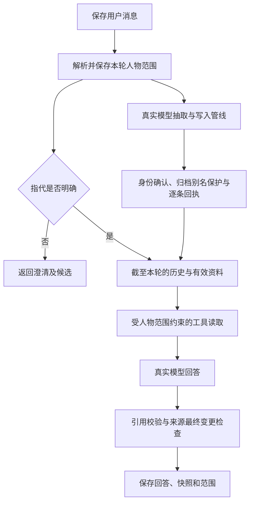
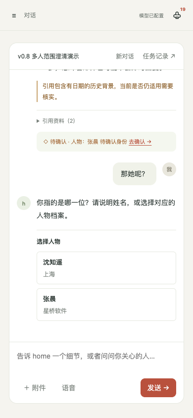

# 0.8 记忆问答与检索验收

日期：2026-10-19。开发分支：`home/memory-quality-v08`，起点为已推送的 `main` 合并提交 `9270eb5`。0.7 功能提交为 `57b08d3`，已合并并推送；本次 0.8 在独立分支上交付。

## 实现

- 查询侧清理标点及少量功能词，不改变既有全文索引。精确匹配优先；明确人物、人物集合或个人范围时，允许有界的部分词项和中文子串候选，返回实际匹配类型。
- 全文、补充子串和可选向量候选在截取之前应用可见性与人物范围。`retrieval_mode='fts'` 完全跳过 embedding。本次没有配置 embedding，未进行向量效果比较。
- 用户消息保存本轮人物范围和原始锚点。单人后的代词可以承接；新人物覆盖旧焦点；多人、同名、失效或不明确指代先澄清。裸数字或“第二个”不绑定模型可能改变的候选顺序。
- `get_person` 和 `query_memory` 接受后端读取范围，拒绝模型传入的范围外人物 ID。多个已确认人物会以集合过滤；不会因查询为空退回全库。
- 同名候选显示姓名与公司、城市等背景。按钮重新核对保存的候选和该轮用户问题，再以具体人物继续原问题；界面显示所选人物背景。切换会话后的迟到响应不会发送到新会话。
- 重试旧用户问题时，历史截断到该问题；含后续回合的摘要不用于旧问题重试，也不会被临时摘要覆盖。
- 仅被归档人物使用的姓名或别名不能通过自动抽取重新生成空档案，原问题证据和跳过回执保留。活动人物共享别名、显式人工选择、手动新建同名人物和彻底清除后的重建按原有入口处理。
- 未知 ASCII 引用标识（如 `[[profile_context]]`）会被识别为无效引用，不进入可信来源。没有代码、链接等保护实例的普通正文标签可清除；存在混合上下文、转义或实体等不确定情况时保留原文并告警，避免损坏 Markdown。



范围约束用于减少人物串用，不是多用户权限系统。会话历史仍可能包含其他人物的既有陈述，共同参与的原始沟通也可能提及其他人。引用存在、来源未变和词面匹配都不能保证模型的推论正确。

## 固定自然问法检索

使用 [冻结语料](../eval/fixtures/memory_questions_v08.json)，共 16 个检索/来源场景，其中 10 个正召回问法、5 个负例和 1 个档案历史场景。资料是虚构记录，问题采用自然语言；这是开发回归集，不是真实用户分布或独立未见基准。

同一份 0.8 评测器和语料分别读取机械导出的 0.7 应用与 0.8 应用。固定问法不会暗中注入人物 ID。每场景独立进程及临时数据库，禁用网络和 embedding；只测试实际工具和 FTS5。

| 指标 | 0.7 | 0.8 |
| --- | --- | --- |
| 正召回场景 | 10 | 10 |
| 平均 Recall@1 | 0.00 | 0.70 |
| 平均 Recall@3 | 0.00 | 0.70 |
| 平均 Recall@5 | 0.00 | 0.70 |
| MRR@5 | 0.00 | 0.80 |
| 运行错误 | 0 | 0 |
| 确定性检查 | 49/51 | 69/70 |

原始结果：[0.7](../eval/results/memory-quality-v08/retrieval-v07.json)、[0.8](../eval/results/memory-quality-v08/retrieval-v08.json)。确定性检查数量随实际结果数量变化，不是统一分母的检索准确率。

仍有明确缺口：

- 两个饮食问题各召回了 2 条标注相关记录中的 1 条，不能算完整召回。
- “阿舟的沟通偏好是什么？”与记录中的电话、邮件没有足够词面重合，恢复场景未召回。恢复后的原文与状态正确，语义召回仍不足。
- 直接调用无会话范围的 `query_memory` 时，“星河科技那个林舟”仍要求澄清，导致 1 项 `tool_completed` 检查失败。会话层可根据唯一公司背景确定范围；这不代表直接检索工具已解决同名语义消歧。

固定集命令因此返回非零状态，失败保留在报告中。没有通过改题、隐藏人物 ID 或把词面补充称为向量检索来抹平这些缺口。原 0.7 生命周期回归仍为 18/18；它使用自己的样本和 `recall_at_k` 口径，不能与上述分数拼接。

## 真实回答与代理审阅

固定 6 组对话、每次重复 13 个回答，真实调用 `harness.run_turn`，保留抽取、工具调用、上下文、写入副作用和多轮历史。模型为 `qwen3.7-plus`，不使用缓存和 embedding。0.7 采样一次，0.8 重复两次；这不是同等采样次数的语义准确率比较。

正式 0.7 的 13 个回答无运行错误，来源及范围等检查通过 207/211，有限字符串规则通过 11/11。四条失败来自同名澄清第二轮的一次越界读取：用户选择星河科技林舟后，模型仍读取南山中学林舟的资料。归档最后一轮还发生了另一种语义错误：猜测用户其实想问老陈，并用个人客户清单作为人物身份引用；来源真实但无法支持结论。见 [0.7 原始回答](../eval/results/memory-quality-v08/answers-v07.json)。

0.8 修复前的两次重复共 26 个回答无运行错误，432/432 来源等检查、22/22 有限字符串规则通过。逐轮代理审阅仍发现了无效引用标记、漏引、记录日期被说成用户修改日期、额外推论，以及归档别名被自动抽取成活动空档案。保留 [修复前原始回答](../eval/results/memory-quality-v08/answers-v08-before-guards.json)，用于追溯这两个确定性保护的来由，而非只保留较好的一轮。

归档别名和无效引用保护补充后，使用同一语料和评测器重新采样。最终 26 个回答无运行错误，确定性检查 **433/433**，有限字符串规则 **22/22**；源码、语料与评测器 hash 在运行期间未变化。见 [0.8 原始回答](../eval/results/memory-quality-v08/answers-v08.json)。这些检查没有判定全部回答语义正确。

逐轮代理审阅发现以下边界：

- 两次同名澄清后的资料读取均限制在选定人物；一次模型把人物 ID 抄短的工具请求被拒绝，仍使用本轮已注入的有效资料回答。修改、撤销、转移后的工具与来源状态检查通过。
- 两次归档后的最后一轮均只保存问题证据，返回“人物目前不可用”，没有再自动建立活动同名档案或读取个人清单猜测人物。
- 两次昵称后的饮食追问都未附引用，系统已告警；另一条“未记录血型”的回答也收到未引用提示，提示仍有噪声。最终采样未生成未知 ASCII 引用标签；该标签的拒绝与告警路径由专门自动回归验证，不能称为本次真实模型已触发。
- `restore-move-archive` 第一次重复第 1 轮把 `historical_background` 错解为“已经被撤销或不再是当前有效状态”，并建议再次恢复；实际记录已恢复，`status=active`、`deleted_at=null`。它还把内部字段名称和 revision 直接输出给用户。这是来源真实但结论错误的明确反例。
- 部分回答仍把生效日期当成用户更正发生日，或把“急事电话、别发长邮件”等记录扩展为普遍建议。转移后的两条联系记录中，第二次重复将电话习惯推为“私事”的做法，原文并未明确这一场景划分。需要更清楚地区分已记录事实与建议。
- 真实抽取总计新增 26 条问题证据、4 条身份待确认、1 条资料记录及 1 条个人意图记忆，没有改写种子事实。唯一昵称仍可能产生多余身份待确认，纯查询也可能被保存成个人意图；读取范围不约束写入管线，抽取质量需另行改进。

人工语义评分仍为 `review_pending`，`score=null`。本次代理审阅只定位具体问题，不冒充人工评测，也不计算语义准确率。

每份 JSON 保存 fixture、runner 和应用源码 SHA256、Git 状态、模型、重复次数和运行期间源码变化标记。基线实现的身份由内容 SHA256 确定，不借用其父目录仓库的分支信息。评测发生在未提交工作树中，报告的 Git HEAD 不是随后提交的代码身份；应使用源码 hash 核对。

## 自动回归与页面

最终自动回归为 **803 passed**，包括评测器负控、人物范围、旧问题重试、真实 SQLite 检索、引用 Markdown 保护与归档别名写入回归。用于验证规则的 stub 不计作真实回答评测。`node --check web/app.js` 与 `git diff --check` 通过。

浏览器使用独立恢复的虚构数据库：

- 真实模型验证同名张晨选择公司后继续原问题、单人代词追问、两人比较后代词需要澄清，以及引用详情原文。
- 1440、390、320 宽度检查；移动导航收起后再截图，页面无横向溢出。
- 用浏览器请求拦截验证候选文本转义、切换会话后的迟到响应、候选读取失败提示且不提交错误问题。拦截测试不作为真实模型质量证据。




## 复现

```sh
.venv/bin/python -m pytest tests/ -q --basetemp=.pytest-tmp
.venv/bin/python -m eval.memory_retrieval
.venv/bin/python -m eval.memory_questions --track retrieval --output-dir /tmp/home-v08-retrieval
.venv/bin/python -m eval.memory_questions --track answers --repeat 2 --output-dir /tmp/home-v08-answers
```

`--app-root` 可指定机械导出的旧版本。默认每场景 600 秒硬超时；结果逐场景原子保存。真实回答命令会调用本地配置的模型，临时数据与本机工作数据库隔离。当前没有 embedding 配置，不能据此作全文与向量质量对比。

便携虚构演示库保留 0.7 来源纠错示例，补充两位张晨的不同沟通习惯及 0.8 同名/指代对话，共 70 位人物（65 位可见）、126 条记忆、6 个会话。全部旧数据行及旧会话原文、引用元数据保持一致。新目录恢复通过 SQLite 完整性、外键、3 份附件哈希与保存引用的证据检查；演示恢复自动测试 5 项通过。另一台机器恢复仓库的 `demo/` 即可查看保存的回答、选择与来源，不需要重新调用模型生成演示。
