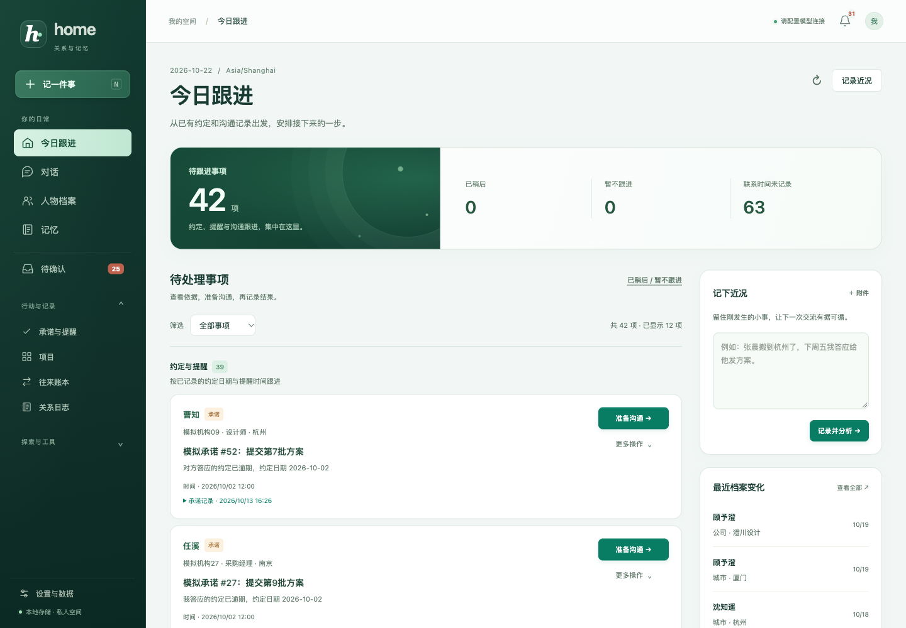
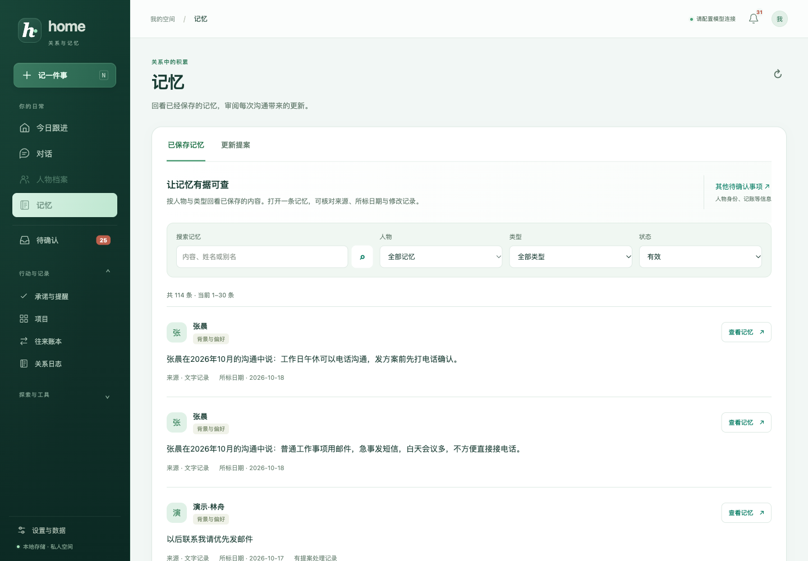
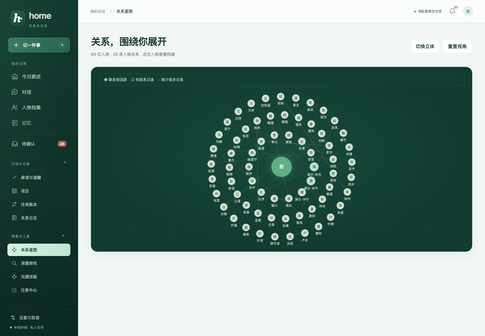

# 0.14 界面展示与 README 更新

日期：2026-10-22。应用仍为 0.14.0。本次更新前端展示层与仓库说明，没有新增模型采样、后台能力或数据库迁移。0.14 的回答与写入质量继续以 [原验收记录](WRITE_QUALITY_V014.md) 为准。

## 界面变更

- 导航采用墨绿渐变，统一品牌标记、选中项、快捷记录和本地图标。
- 今日跟进使用翡翠色主操作和带节点环纹的真实事项计数。辅助统计、事项分组、近况记录及档案变化保持原有数据口径。
- 人物卡片、档案详情、记忆筛选、对话双栏、输入框和弹层采用统一颜色、边框与层次。成功、警告、错误和收支颜色分别保留。
- 关系星图采用深绿点阵画布，保留平面、立体、重置及点击人物操作。图例留出独立区域，不覆盖图中节点。
- 手机保留四个底部入口、完整菜单与历史对话面板。键盘焦点、Escape 关闭和减少动态效果设置继续生效。

实现仅涉及 `web/index.html`、新增的 `web/studio-workspace.css` 与 `web/favicon.svg`。业务 JavaScript、接口、排序规则与保存流程没有修改。

## 实际检查

浏览器使用仓库 `demo/home.db` 与附件的独立恢复副本。预览前初始化数据库，预览进程关闭后台调度与任务恢复，模型密钥置空。全部人物和保存内容为虚构资料，没有发送新消息或调用模型，也没有修改仓库演示快照与工作数据库。

| 检查 | 范围与结果 |
| --- | --- |
| 响应布局 | 今日、对话、人物列表、人物详情、记忆和关系星图，共 6 页，分别检查 320、390、800、1024、1440 宽度，30 个组合均无文档横向溢出。 |
| 视觉检查 | 1440 桌面与 390 / 320 手机共 18 张实际截图逐张审阅，未发现新增文字重叠、按钮被底栏遮住或图例覆盖节点。 |
| 今日与对话 | 切换今日事项筛选；搜索并切换已保存历史会话；桌面和手机打开引用详情并通过 Escape 关闭，详情无横向溢出。 |
| 手机导航 | 打开历史对话后展开全局导航，历史面板关闭。Escape 关闭导航并将焦点恢复到菜单按钮；选择历史会话后面板自动关闭。 |
| 人物页签 | 通过键盘方向键从概览进入沟通分区，选中状态与地址同步更新。 |
| 前端检查 | 两份业务 JavaScript 的 `node --check` 通过，现有 6 项 Node 界面回归通过，`git diff --check` 通过。新版检查期间无页面脚本异常或 HTTP 错误响应。 |

本次没有重跑全部 Python 自动测试，也没有为各个尺寸重复执行写入。截图和界面检查不代表模型回答质量改善，不覆盖所有设备与浏览器。66 人物的密集星图在窄屏会整体缩小，标签较小，README 使用桌面星图展示。

## README 展示

去掉了产品定位中的外部产品参考，增加本地 SVG 品牌封面、技术标签、页内导航、当前 UI 图集、手机预览及 Mermaid 架构图。原有验收表完整保留并收起展示，详细使用和数据边界继续保留。

图片均位于 [assets/readme/](assets/readme/)，对话图保留原有消息、日期与来源提醒，没有改写历史答案。截图来自本次前端，底层演示数据仍为 2026-10-19 的固定快照。

