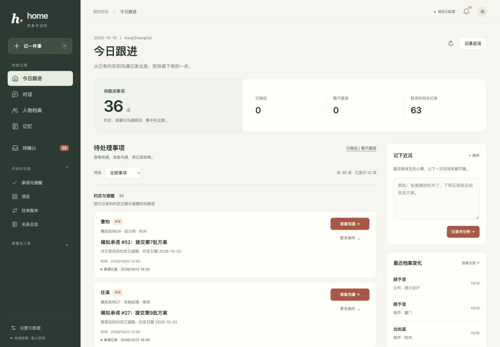
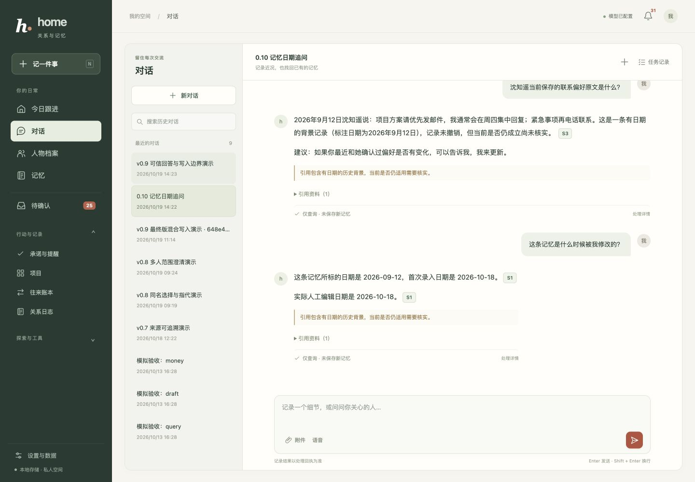
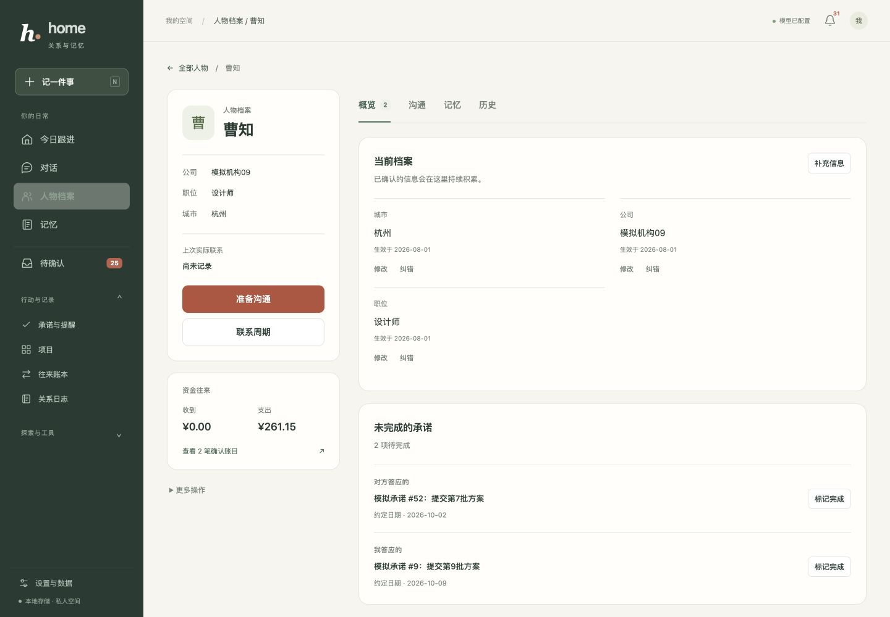
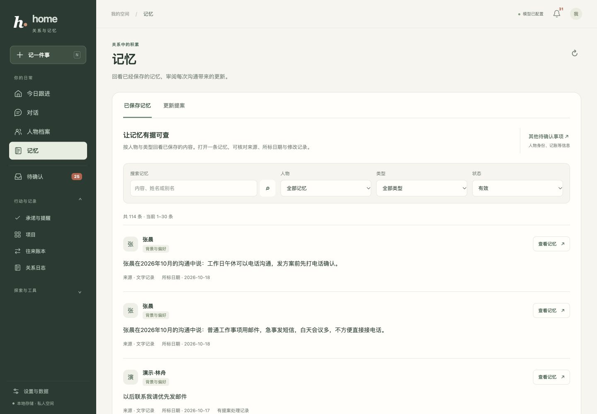
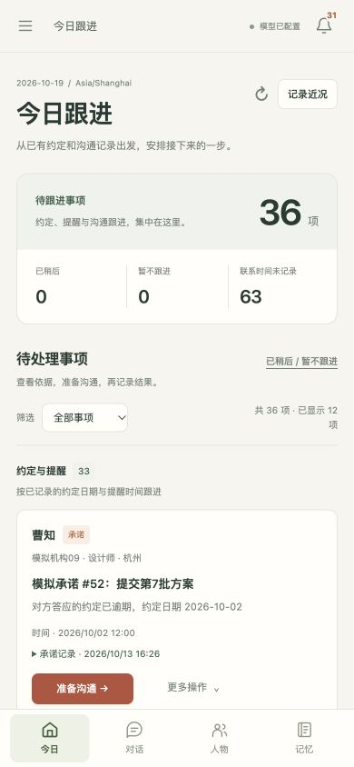
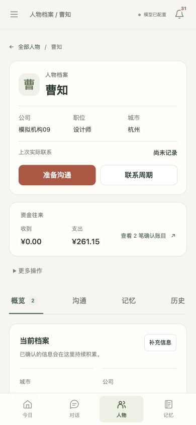
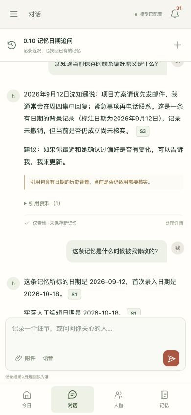
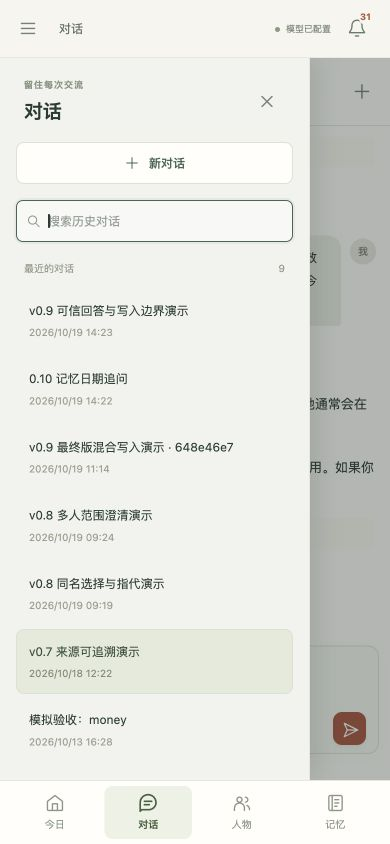

# 0.11 布局与工作台验收

日期：2026-10-19。应用版本：0.11.0。已完成现有 1139 项自动回归、桌面与手机浏览器检查，以及独立虚构数据上的沟通结果保存验证。检查范围与具体结果如下。

## 改动范围

本轮围绕「记录近况 → 审阅提案 → 查看人物与记忆 → 准备沟通 → 记录结果」整理入口与页面层级。桌面侧栏对功能分组，突出今日、对话、人物和记忆；待确认、任务和其他已有功能仍保留入口。颜色延续米白、深绿和砖红，统一图标、间距、文字层级、表单与操作样式。

| 核心页面 | 布局与交互 |
| --- | --- |
| 今日跟进 | 待跟进总数优先呈现，已稍后、暂不跟进和联系时间未记录为次级统计。按既有事项类型分为约定与提醒、沟通跟进、联系周期建议；每条提供准备沟通主操作，打开跟进、完成约定、稍后和暂不跟进收进更多操作。快速记录与近期档案变化置于辅助区域，未记录联系时间的名单默认收起。 |
| 对话 | 历史会话提供搜索与新建入口，消息、引用及处理回执保持可读层级。手机可从标题栏打开历史会话面板，选择旧会话；输入区保留草稿、附件、取消与发送能力。 |
| 人物档案 | 人物由长抽屉调整为独立详情页，身份信息、实际联系时间、沟通准备与联系周期保留固定入口。主内容分为概览、沟通、记忆、历史，资金往来与低频档案维护操作分区呈现。 |
| 记忆 | 已保存记忆和更新提案分别展示用途说明，筛选区和列表采用统一布局；来源、日期、修改与提案审阅继续沿用原有流程。其他待确认事项保留独立入口。 |

今日事项只按接口已有的 `kind` 分组，不在前端计算新的紧急度，也不改变后端日期与排序规则。筛选、分页、来源、fingerprint、隐藏与恢复、联系周期的后台契约继续使用原接口。

## 深链、日期与状态

人物详情地址为 `#/persons/<person_id>`。沟通、记忆与历史页签分别支持 `?tab=communication`、`?tab=memory`、`?tab=history`；概览使用默认地址。页签切换更新地址，支持刷新直达与键盘左右方向键、Home、End 操作。

历史区的日期输入向既有历史接口传递 `at`，留空展示全部版本；切换人物页签时保留当前人物已选的日期。日期筛选没有被编码为新的 URL 参数，不宣称可通过深链保存这一筛选。历史读取失败保留重试入口。

人物记忆区仍可进入该人物的完整记忆列表或待审阅提案。记忆页现有的人物、类型、状态、搜索与分页参数继续保存在地址中；修改、撤销恢复和提案确认使用已有接口与修订检查。

## 手机与可访问性

手机底部保留高频导航，完整导航从菜单展开，历史会话从对话标题栏打开。导航与历史会话面板互斥，避免同时覆盖内容。隐藏的面板使用 `inert`，展开时设置对应的可访问状态；打开后将焦点移入，关闭后恢复到仍存在的触发控件。

侧栏、历史会话面板与已有弹窗包含 Tab 焦点约束，可通过 Escape 关闭当前面板。图标按钮保留可读名称；人物与记忆页签使用 tab / tabpanel 语义，主操作和更多操作均可键盘访问。跨桌面与手机宽度切换时同步面板状态。

异步读取用当前页面、人物或会话及请求标记核对返回内容。切换人物、页签或会话后，迟到的历史、记忆和消息回包不能覆盖新页面；重试与错误提示仍留在所属视图。人物维护操作返回时也核对原路由，避免迟到的保存结果把用户带回旧页面。

从人物页创建跟进、完成准备任务、记录实际沟通结果或处理记忆提案后，重新读取底层人物工作区，保留当前页签、历史日期及已打开的弹层。刷新失败会单独提示「已保存，档案暂时无法刷新」，不把已经完成的保存显示成失败。已丢弃或待审阅提案使用「建议生效日期」，只有已入档提案显示「生效日期」。

## 验证记录

自动回归：**1139 passed，10.10s**。运行范围为 `tests/`；覆盖既有 API、任务、查询写入边界、来源快照、记忆处理、事务与并发规则。

浏览器使用内置浏览器，所有尺寸均为 CSS 像素：

| 场景 | 范围与结果 |
| --- | --- |
| 响应布局 | 今日、对话、人物列表、人物详情、记忆库在 320、390、800、1024、1440 宽度下，文档 scrollWidth 均等于 viewport 宽度。桌面 1440 与手机 390 / 320 检查实际截图；最终恢复默认窗口尺寸。 |
| 今日跟进 | 桌面查看事项分组、筛选沟通跟进、展开更多操作与承诺来源；手机核对指标、列表、主操作及底部导航。 |
| 对话 | 桌面搜索并切换真实演示会话、打开引用详情；390 / 320 下打开历史面板、搜索、切换、自动关闭与 Escape 返回。纯查询回执默认收起，失败重新分析入口仍显示。 |
| 人物 | 检查四个页签、历史深链刷新、日期有记录与空态、页签间日期保留、编辑弹窗开关、人物列表搜索及 Enter 进入。390 下检查方向键页签切换，320 下查看人物记忆详情并返回历史。 |
| 记忆 | 390 下按人物筛选、查看来源与处理历史、打开纠错表单、切换提案视图及全部状态，打开已丢弃提案并核对日期标签。320 下核对筛选布局，记忆与引用弹窗均未横向溢出。 |
| 焦点与导航 | 390 下检查历史面板与全局导航互斥、侧栏 Tab 循环、Escape 与触发按钮焦点恢复；320 下检查引用弹窗首尾 Tab 循环及导航开关。 |
| 保存后的同步 | 在独立副本中新建一次性虚构人物、已准备跟进与承诺，通过浏览器保存电话沟通并完成承诺。弹层保持打开，底层联系时间更新、跟进变为已完成、未完成承诺由 1 变为 0。验收后清除该临时人物及关联记录，外键检查无错误。 |
| 脚本错误 | 验收标签的浏览器 warning / error 日志为空；两个前端脚本通过 node --check，git diff --check 通过。 |

另用临时 Node VM 直接执行当前函数验证：11 个维护操作的同路由与迟到分支共 22 项通过；写入后刷新、关闭弹层、刷新失败、生成较慢及生成已完成两种任务时序共 19 项通过。人物历史读取另检查日期逆序返回及切人物迟到隔离。这些是前端状态分支检查，不计入 1139 项 Python 自动回归，也没有调用模型。

运行自动测试时明确指定 `tests/`，避免收集本机 `data/qa/` 内历史版本副本中的同名测试文件。本轮未在每个设备尺寸重复提交写入，也未逐一重新触发所有网络错误；已有接口和并发规则由现有自动测试覆盖。

截图记录：

## 数据与限制

浏览器验收使用从仓库虚构演示数据恢复的独立数据库，目录为 `data/qa/ui-workspace-v011-20261019/preview/`，预览地址为 `http://127.0.0.1:8774/`。一次性写入样本验收后已清除；本轮不更新仓库的 `demo/home.db`，正式数据库不参与验收。演示附件和数据库仍按既有恢复说明使用。旧的 8773 预览服务在确认没有运行中任务后关闭，保留 8774。

本轮没有新增模型调用或真实回答采样。1139 项自动测试和页面交互验证不表示回答准确率提高，也不覆盖全部设备和浏览器。0.10 已记录的分类格式失败、普通问法中的日期误述、追问取源连续性及其他回答问题继续以 [0.10 验收报告](ANSWER_STABILITY_V010.md)和[逐轮审阅](ANSWER_STABILITY_V010_REVIEW.md)为依据。
